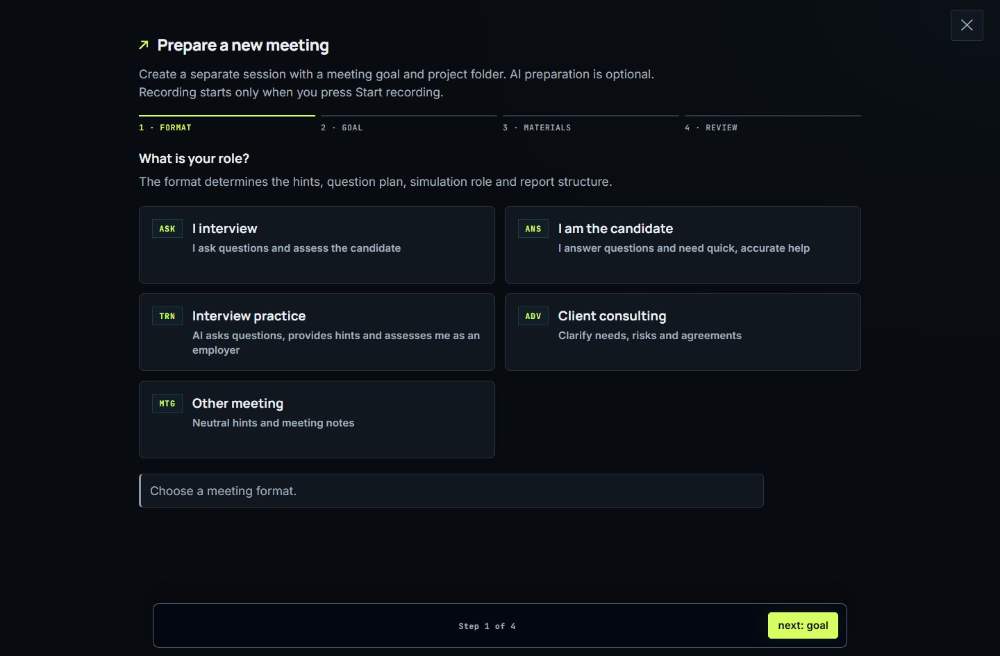
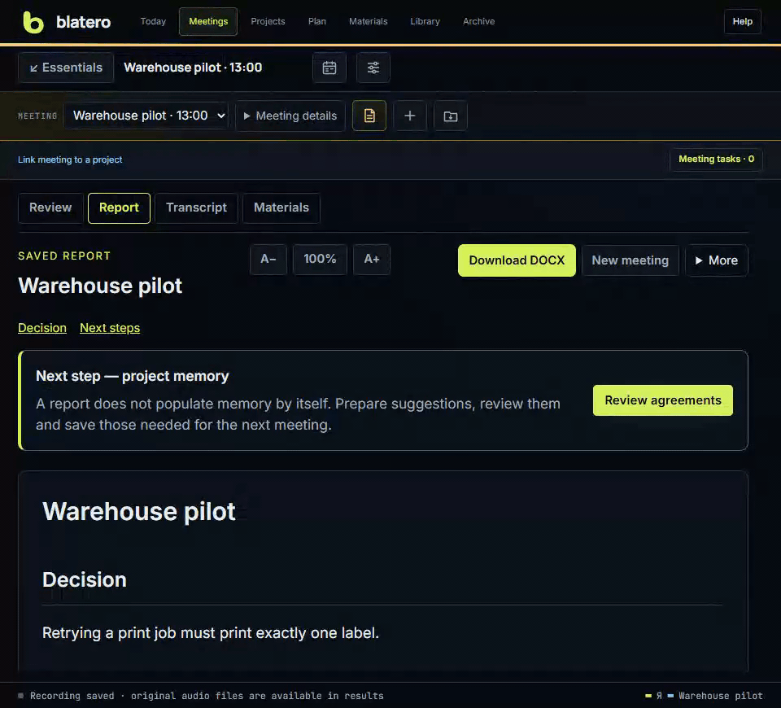

# Blatero

[Русский](README.md) · [English user guide](docs/wiki/en/Home.md)

By **androman** · [androman.pro](https://androman.pro) · [Telegram](https://t.me/andromanpro1c)

Blatero's own code is [MIT-licensed](LICENSE). See [third-party notices](THIRD_PARTY_NOTICES.md)
for components distributed under their own licenses.

**Record a meeting, verify its outcomes against the audio, and keep decisions
with the project.** Blatero runs on your computer. It captures the microphone
and meeting audio separately, offers transcripts and live hints, and helps you
review a draft report and turn decisions into project tasks.

[**Download the Windows portable preview**](https://github.com/andromanpro/blatero/releases/tag/v1.0.2-rc.8)
· [Get started](docs/wiki/en/Home.md)

## From conversation to a project task

<picture>
  <source media="(max-width: 600px)" srcset="docs/showcase/workflow-en-mobile.svg">
  
</picture>

In this sample meeting, a warehouse team needs to make sure only one label
prints after a failure. The team can check the decision against the recording
and keep the next step with the task.

Watch: switch from the saved report to the original transcript (GIF)

## When to use Blatero

- **Recurring project meetings.** Bring up past agreements and materials before
  a call. Afterward, keep the confirmed decision with its project task.
- **Consultations and technical interviews.** Ask for a follow-up question during
  the conversation. Check a disputed conclusion against the transcript or audio
  instead of replaying the whole call.
- **Practice.** Try an interview from either side or explain a project in two
  minutes, repeat and compare attempts. Keep experiments in the test environment.

## Try it with a sample meeting

1. Extract the full [Windows archive](https://github.com/andromanpro/blatero/releases/tag/v1.0.2-rc.8)
   and run `Blatero.exe`.
2. Choose **Help → Run a meeting → Show me around** to find the controls for
   preparation, audio checks, recording and results.
3. Use the test environment for a short recording. Open the transcript,
   then check the report against it. Report generation requires a configured
   AI provider.

**Your data and decisions.** Switching speech engines should not interrupt WAV
capture. Saving a report does not change tasks on its own. Local Whisper is an
option for recognition; cloud services receive the data needed for the chosen
operation. See [privacy and providers](docs/wiki/en/Privacy-and-Providers.md).

<!-- end-showcase -->

## English interface status

Select **English** in
**Settings → Appearance → Interface language**. On the standalone task board,
open **Settings** in the top bar. Meeting/results, settings, task workflows,
studio, library, labs and maintenance have RU/EN interface labels. External/native
diagnostics can retain their original language. Detailed [English help](docs/wiki/en/Home.md)
and Russian help are included as offline HTML in portable.

The choice is saved in this browser. It does not change the meeting language,
the transcription engine or the language of AI-generated text. User names,
tasks, source documents and reports are not automatically translated. Current
live recognition profiles are Russian-focused; EN interface is not EN STT support.

## Optional apps

Blatero does not require Granka, Neon Legion or Motivelium.

- **Neon Legion**: read local AI usage logs and match them to linked tasks.
  API-equivalent cost is not the subscription bill.
- **Granka**: read article snapshots and publishing dates. Editing stays in Granka.
- **Motivelium**: a separate tool for video work; no direct connector is implemented.

Neon Legion and Granka are disabled by default. Enable them in **Settings →
Connections**. Disabling keeps existing snapshots and links. There is no automatic
installation or launch of their interfaces. Reading Granka runs its local exporter
only after opt-in; its article originals are not modified by the Blatero adapter.

The built-in **Help → Other apps** section links to the related projects.

## Data and providers

Original WAV files are separate from speech recognition. Switching a recognition
engine must not restart capture or rewrite existing WAV files. New recording
segments and training attempts use separate files.

Local Whisper can recognize speech without a cloud key. Yandex SpeechKit sends
audio to Yandex. AI hints and reports use the selected provider; cloud processing
requires explicit acknowledgment. UI language is not a cloud permission.
See [privacy and data flows](PRIVACY.md).

## Development status

The [public Windows portable build](https://github.com/andromanpro/blatero/releases/tag/v1.0.2-rc.8)
is a preview, not a stable release. The release page lists the checks performed
and explains the difference between the project signature and Windows publisher signing.
See [the pilot-testing guide](docs/wiki/en/Pilot-Testing.md) for steps to check
the portable build and your audio setup before an important meeting.

Windows audio development uses Python 3.12 and the pinned dependencies in
`requirements.lock`. Run tests against disposable data with paid/cloud calls
mocked. `tests/offline/sitecustomize.py` provides an opt-in external-network guard
when `tests/offline`, `tests` and the repository are on `PYTHONPATH`.
