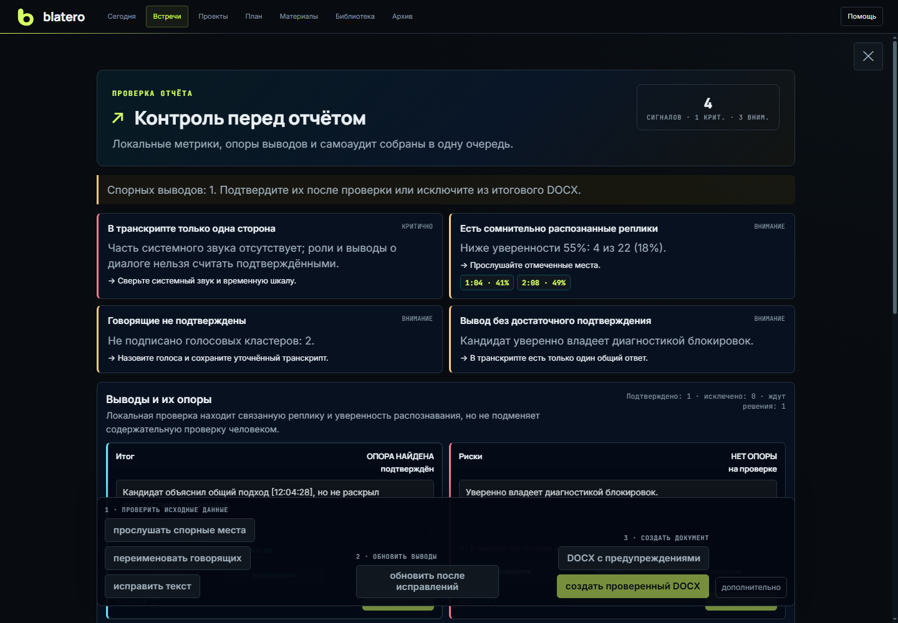
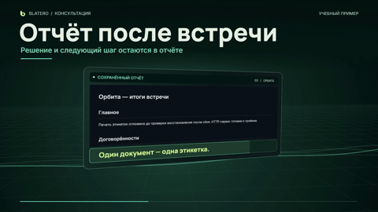

# Blatero

[English overview](README.en.md) · [Интеграции и язык](docs/wiki/Integrations-and-Languages.md) · [MIT](LICENSE)

Автор: **androman** · [androman.pro](https://androman.pro) · [Telegram](https://t.me/andromanpro1c)

**Запишите встречу, проверьте выводы по записи и сохраните договорённости в проекте.**
Blatero работает на компьютере участника. Микрофон и звук собеседников пишутся
раздельно; во время разговора доступны транскрипт и подсказки, после — черновик
отчёта, задачи и память проекта.

[**Скачать portable для Windows**](https://github.com/andromanpro/blatero/releases/tag/v1.0.2-rc.9)
· [Начать работу](docs/wiki/Workspace-Quickstart.md)
· [Обзор с примерами](https://androman.pro/2026/11/06/blatero-posle-vstrechi/)



## Запись без подготовки

**«Записать сейчас»** начинает новый разговор. Во время записи **«Контекст записи»**
позволяет подключить подготовленную встречу, проект, задачу и рабочую папку.
Выбранный ИИ может определить тему по расшифровке и создать карточку во входящих.

В **Настройки → Интеграции** доступны автоматический запуск записи по использованию
микрофона Телемостом или Толком и разрешение на такое начало. Во время mute внутри
приложения встречи Blatero продолжает захватывать выбранный микрофон, включая вашу
речь. Завершение записи выполняется кнопкой **«Стоп»** в Blatero.
[Порядок действий](docs/wiki/User-Guide.md#начать-запись-сразу).

## От разговора до задачи

<picture>
  <source media="(max-width: 600px)" srcset="docs/showcase/workflow-ru-mobile.svg">
  
</picture>

В учебном примере команда обсуждает печать этикеток: после сбоя нужно
проверить, что система печатает ровно одну этикетку. Решение можно сверить
с записью и сохранить рядом с задачей.

<details>
<summary>Посмотреть, как решение из отчёта попадает в проект (GIF)</summary>



</details>

## Когда пригодится Blatero

- **Повторные встречи по проекту.** Поднимите прошлые договорённости и материалы
  перед созвоном. После встречи сохраните подтверждённое решение рядом с задачей.
- **Консультации и технические интервью.** Во время разговора можно запросить
  уточняющий вопрос. После — проверить спорный вывод по реплике, а не переслушивать
  весь звонок.
- **Тренировка.** Выберите роль собеседника или попробуйте объяснить проект за две
  минуты, повторите попытку и сравните результаты. Для экспериментов есть
  отдельный тестовый контур.

## Что попробовать первым

1. Распакуйте весь [архив для Windows](https://github.com/andromanpro/blatero/releases/tag/v1.0.2-rc.9)
   и запустите `Blatero.exe`.
2. Откройте **«Помощь → Провести встречу → Показать на экране»**. Тур показывает,
   где подготовить встречу, проверить звук, начать запись и открыть результат.
3. Сделайте короткую учебную запись в тестовом контуре. Откройте транскрипт,
   затем отчёт и сверьте его с исходными репликами. Для формирования отчёта
   понадобится настроенный провайдер ИИ.

**Что остаётся под вашим контролем.** Смена распознавания не должна прерывать
запись WAV. Сохранение отчёта само по себе не меняет задачи. Для работы без
облачного распознавания есть локальный Whisper; если выбраны облачные службы,
им передаются данные, нужные для выбранной операции. Подробности —
в [руководстве по приватности](docs/wiki/Privacy-and-Providers.md).

<!-- end-showcase -->

## Руководство и настройки

Устройство программы и точки входа для изучения кода описаны в
[карте исходников](docs/development/README.md). Изменения публичных выпусков
собраны в [журнале версий](CHANGELOG.md).

Для распознавания доступен локальный Whisper или Yandex SpeechKit.
Подсказки и отчёты используют выбранного провайдера; облачная обработка
зависит от ваших настроек и подтверждения.

Пошаговое руководство: **[как пользоваться Blatero](docs/wiki/User-Guide.md)**.
Разбор записей, разделение говорящих и назначение имён собраны в
**Инструменты → Аудио и говорящие**.

Начните с [единого пространства](docs/wiki/Workspace-Quickstart.md): встреча,
рабочая задача или возвращение к решению. Кнопка **«Помощь»** в общей шапке
открывает маршруты обучения на встрече и на доске. Состав и результаты проверки
готовой сборки указаны на [странице выпуска](https://github.com/andromanpro/blatero/releases/tag/v1.0.2-rc.9).

Локальная Wiki входит в portable-сборку как `docs/wiki/Home.md`. Настройка
OpenRouter, Codex, OpenAI API и Yandex SpeechKit описана в
`docs/wiki/Provider-Setup.md`.

См. также [приватность и провайдеры](docs/wiki/Privacy-and-Providers.md)
и [проверку на своём оборудовании](docs/wiki/Pilot-Testing.md).

### Эталон качества распознавания

Откройте **Инструменты → Аудио и говорящие → Эталон качества**, чтобы превратить
архивные записи в локальный проверяемый корпус. Для каждой встречи Blatero
создаёт отдельный черновик: исходный транскрипт, WAV и отчёт остаются неизменны.
В карточке реплики можно прослушать точный фрагмент, поправить текст, время,
сторону, канал и имя либо разделить склеенные голоса на две реплики.

После ручной сверки включите подтверждение и нажмите **«подтвердить эталон»**.
Только такие записи участвуют в общей WER, DER/JER, ошибке канала и ложном
подавлении эха. Подтверждённую разметку можно просматривать; для новой правки её
сначала нужно явно вернуть в черновик. Целевой первый набор — 10–20 реальных
встреч, поэтому наличие экрана само по себе не выдаётся за завершённую
калибровку качества.

## Установка

### Переносимая Windows-сборка (без установленного Python)

Скачайте `blatero-portable-<версия>-win-x64.zip` и соседний файл `.sha256`,
сверьте контрольную сумму и распакуйте **весь** ZIP в отдельную папку. Затем
запустите `Blatero.exe`: в меню можно проверить установку, открыть документацию
или поднять локальный сервер. Браузер откроется после проверки готовности.
Основные зависимости уже включены, поэтому для первого запуска не нужны
системный Python и PyPI.

Корень portable-папки намеренно короткий: `Blatero.exe`,
`PORTABLE_README.txt`, `app`, `docs`, `runtime` и `_integrity`. Технический
`app\start_blatero.cmd` остаётся запасным вариантом для диагностики.

По умолчанию launcher получает фактическую папку «Документы» через Windows Known
Folders и сохраняет данные в её подкаталоге `Blatero`, а не рядом с программой.
Это работает и для перенаправленной/OneDrive-папки. Для проверки
Ed25519-подписи и SHA-256 каждого файла распакованным runtime выполните:

```powershell
.\runtime\python.exe .\app\ci\build_windows_portable.py --verify `
  <путь-к-blatero-portable.zip>
```

Portable-пакет подписан внутренним релизным ключом Blatero, но пока не имеет
публичной Authenticode/MSIX-подписи издателя. Поэтому Windows может показать
предупреждение SmartScreen. Публичная Authenticode/MSIX-поставка исключена из
текущего плана; целевой канал — локальный OSS и проверяемый portable ZIP.

### Подписанный пакет и отдельный каталог данных

Для обычной установки запустите `install_blatero.cmd`, выберите подписанный
`blatero-<версия>.zip`, пустой каталог программы и отдельный каталог данных.
Установщик до распаковки проверяет Ed25519-подпись манифеста, SHA-256 и размер
каждого файла, затем создаёт изолированную `.venv` и ярлык на рабочем столе.
Требуются установленный Python 3.12 и доступ к PyPI для первой установки.

В каталог данных попадают `sessions`, настройки, календарные токены, память
клиента и проекта, модели, голосовой профиль и очередь обновлений. Локальный
указатель `.blatero-data-dir` связывает программу с данными и не входит в релиз:
замена кода не может перезаписать записи встреч. Исходная Git-копия остаётся
совместимой и без указателя использует прежнее размещение рядом с кодом.

В установленной копии откройте **Инструменты → Обновления**. Кнопка выбора сначала
проверяет подпись и показывает версию, размер, число файлов и сокращённый хеш.
Подготовленный пакет применяется launcher-ом только при следующем запуске, когда
прежний сервер уже остановлен. Изменённые файлы архивируются;
после успешного обновления доступен одношаговый откат. Активное Python-окружение
не обновляется `pip install` по месту: если новый релиз меняет lock зависимостей,
launcher возвращает предыдущий код и просит поставить полный portable/installer.
Рабочая Git-копия защищена от пакетной перезаписи.

Текущий локальный установщик и релизный архив защищены собственной подписью
Blatero. Windows Authenticode для самого `.cmd`/будущего `.exe` потребует
отдельного сертификата издателя; такую публичную поставку проект не планирует.

### Восстановление после сбоя

Во время записи Blatero ведёт атомарный журнал состояния рядом с файлами встречи.
Если компьютер выключился, процесс был убит или запись не успела закрыться,
следующий запуск показывает экран **«Восстановление»**. На нём видны
сохранённая длительность, число реплик, состояние каждой WAV-дорожки и конкретные
проблемы.

Кнопка **«восстановить и открыть»** сохраняет каждый изменяемый исходник рядом
с суффиксом `before-recovery`, исправляет только размеры RIFF/data и оборванную
последнюю строку JSONL, затем пересобирает Markdown. Повреждение внутри журнала
автоматически не маскируется. Можно также оставить файлы без изменений и
завершить встречу как прерванную либо удалить только известные временные файлы.
Продолжение всегда создаёт новый сегмент: существующий звук и транскрипт не
перезаписываются. Все действия восстановления доступны только с localhost.

До первого изменения Blatero считает полный бюджет: копии исходников, временные
файлы и защитный резерв. SAFE показывает «нужно / свободно» и блокирует ремонт,
если места недостаточно или его объём не удалось проверить. Backup сначала
пишется под временным именем, синхронизируется с диском и только затем атомарно
публикуется как `before-recovery`; неполная копия не выдаётся за готовую.
В CI этот порядок проверяет `ci/power_loss_soak.py`: отдельные процессы жёстко
обрываются во время копирования и на семи границах восстановления.

Тот же экран отдельно показывает оборванные фоновые задачи. Для отчёта Blatero
сохраняет проверяемую контрольную точку `report.draft.md` +
`report.draft.json`: если текст и хеш источника совпадают, очередь проверки
восстанавливается локально без нового LLM-запроса. Повторный анализ рабочей
папки или отчёт без целой контрольной точки никогда не стартует автоматически:
интерфейс предупреждает о возможной оплате и требует отдельного подтверждения.
Завершённые результаты не удаляются при очистке временных файлов.

Каждая новая сессия имеет единый commit-marker `.session-schema.json` и версию
схемы в `meta.json`. Старая сессия обновляется лениво только при открытии:
сначала атомарно создаются журнал `.session-migration.json` и побайтовая копия
`meta.before-schema-v1.json`, затем публикуется новый `meta.json` и лишь после
этого — манифест схемы. Прерванная миграция появляется в **SAFE** и повторяется
идемпотентно; сессия из более новой версии Blatero блокируется без изменения
файлов. Пять реальных границ аварийного завершения проверяет
`ci/schema_migration_soak.py`.

Сборка релиза выполняется только владельцем закрытого signing key. Удобный
релизный шаг собирает и сразу проверяет source ZIP и portable ZIP:

```powershell
.\.venv\Scripts\python.exe ci\release_step.py `
  --signing-key <путь-к-release-signing-key.pem>
```

Первичная инициализация ключа для внутренней поставки:

```powershell
.\.venv\Scripts\python.exe ci\release_step.py --init-key
```

Приватный ключ не должен находиться в репозитории или каталоге установки;
`release_public_key.pem` содержит только публичную часть для проверки.

### Установка из исходников

Для этого варианта требуется Windows и Python 3.12: `PyAudioWPatch` привязан к
доступным wheels.

```powershell
py -3.12 -m venv .venv
.\.venv\Scripts\python.exe -m pip install -r requirements.lock

# отдельное окружение локального клонирования голоса
py -3.12 -m venv .venv-tts
.\.venv-tts\Scripts\python.exe -m pip install -r requirements-chatterbox.txt
```

### Менеджер локальных моделей

После первого запуска откройте **Инструменты → Локальные модели**. Экран показывает
для каждого компонента назначение, требования CPU/RAM, лицензию, фактически
занятое место, каталог и состояние проверки. Там можно подготовить:

- Whisper base/small/medium;
- WebRTC AEC3;
- CPU-модели разделения голосов;
- Chatterbox Multilingual V3 вместе с изолированным окружением.

Новые Whisper-модели хранятся в `.models/whisper/` каталога данных Blatero, а не
в пользовательском кэше системного диска. Предзапуск проверяет именно наличие
выбранной модели: сервер не начинает запись без неё и предлагает открыть менеджер,
чтобы встреча не закончилась WAV без транскрипта. Активную модель Whisper удалить нельзя — сначала выберите
другую в настройках.

Старый общий Hugging Face cache может отображаться отдельным жёлтым блоком.
Он доступен менеджеру только для чтения и не очищается автоматически: тот же
cache могут использовать другие программы. Кнопка удаления затрагивает только
зарегистрированные каталоги Blatero. Для Chatterbox удаляются зависимости и
веса, но сохраняются записи встреч и образец вашего голоса; образец удаляется
отдельной кнопкой в проверке звука.

Ключ SpeechKit хранится в `%USERPROFILE%\.yc-speechkit-key`. API-токены LLM
вводятся через **Инструменты → Настройки → ИИ и автоматизация** и сохраняются в Windows
Credential Manager, а не в `config.json` или Git. Старые установки продолжают
читать OpenRouter из `OPENROUTER_API_KEY` или `git config openrouter.apiKey`, но
для новых подключений рекомендуется форма панели.

Для режима подписки установи Codex CLI и один раз войди через ChatGPT:

```powershell
codex login
codex login status
```

Второй вызов должен показать `Logged in using ChatGPT`. В панели доступны:

- OpenRouter — единый ключ для моделей разных компаний;
- Codex — вход через подписку ChatGPT без API-токена;
- прямые API OpenAI, Anthropic и DeepSeek;
- Ollama, vLLM, LM Studio или другой OpenAI-совместимый endpoint.

После выбора провайдера панель показывает, где получить токен, какие расходы
оплачиваются отдельно и какой адрес используется. Вставьте токен и нажмите
**«проверить соединение»**: проверяется авторизация или список моделей, но текст
встречи и файлы не отправляются. Успешно проверенный новый токен сохраняется в
Credential Manager. Для совместимого сервера задаётся `Base URL`; для Ollama по
умолчанию это `http://127.0.0.1:11434/v1`, токен обычно не нужен. Поля моделей
редактируемые — можно указать точный идентификатор, доступный вашему аккаунту.

В карточке **«Приватность»** блок **«Контур данных»** показывает четыре
фактических маршрута: LLM, STT, TTS и локальный разбор голосов. Метки «локально»,
«облако» и «локально → облако» строятся из контракта
`blatero.provider-contracts/v1`, а потенциальный облачный маршрут без ручного
согласия отмечается как выключенный. Для совместимого API решение принимается
по адресу: loopback считается локальным, внешний HTTPS endpoint — облачным.

При выборе Codex поля токена и моделей скрываются; платного fallback на другой
провайдер нет. Codex запускается изолированно, без инструментов проекта и без
сохранения своей сессии. Подписка не распознаёт речь: для этого выбирается
локальный Whisper либо SpeechKit.

### Системные промпты

Откройте **Инструменты → Настройки → Сценарий и интерфейс → системные промпты**.
Редактор показывает 33 реально используемые инструкции и шаблоны: подсказки для
каждого типа встречи, быстрый ответ кандидату, отчёты, SIM, анализ рабочей папки,
банк вопросов, досье и тренировочный спарринг. Слева они сгруппированы по
назначению, справа доступны текущий текст, заводской вариант и обязательные
служебные маркеры.

После сохранения локальная версия применяется к следующему запросу модели без
перезапуска панели. Переопределения лежат в `prompt_overrides.json`; файл
исключён из Git и не затрагивает исходный код. Кнопка «сбросить к заводскому»
удаляет только выбранное переопределение. Редактор доступен исключительно с
этого компьютера, даже если панель запущена с `--lan`.

Перед записью шаблон проверяется: обязательные подстановки вроде `{transcript}`
и `{tail}` нельзя удалить или переименовать, неизвестные поля и повреждённые
фигурные скобки отклоняются. Правила обработки недоверенных документов,
обезличивание и техническая изоляция провайдера намеренно не редактируются и
добавляются программой отдельно.

Blatero не умеет автоматически определить юридическое согласие по голосу. Флаг
является ручной записью оператора: его можно переключить в карточке
**«Приватность»** или командой после получения согласия участников:

```powershell
.\.venv\Scripts\python.exe config.py --ack-cloud
```

В панели это та же настройка: **Инструменты → Настройки → Приватность → «Согласие
получено»**. Достаточно поставить галочку; отдельная команда не нужна. Галочка
сохраняется в `config.json`, поэтому перед новой встречей её состояние следует
проверить и при отсутствии основания снять.

Отозвать подтверждение: `python config.py --revoke-cloud`. Подробности — в
`PRIVACY.md`.

По умолчанию аудио распознаётся локальным `faster-whisper` (`small`), а текст
перед любым LLM проходит локальное обезличивание ФИО из подписанных полей,
телефонов, email, адресов, URL и идентификаторов. Модель Whisper скачивается один
раз при первом запуске и затем берётся из локального кэша. Обезличивание снижает
риск, но не гарантирует удаление любых ПД из произвольной речи; режим передачи
исходного текста включается только явным выбором с предупреждением.

Говорящие разделяются не по голосовому отпечатку, а по источнику: микрофон —
каноническая роль `[Я]`, системный loopback — `[Собеседник]`. В настройках звука
нужно выбрать не только микрофон, но и **тот же выход, который использует
приложение встречи**.
Обе видимые подписи можно переименовать; технические роли в исходном транскрипте
остаются стабильными, а подсказки и отчёт получают расшифровку имён из
`meta.json`. Whisper и Yandex SpeechKit можно переключить во время записи:
WASAPI-захват и те же WAV не останавливаются. Новый движок готовится отдельно;
при ошибке подготовки прежний остаётся активным. Для активного SpeechKit
требуется ручное облачное подтверждение.

При локальном Whisper оба аудиоканала начинают писать WAV до загрузки модели:
первые реплики не теряются, а панель показывает состояние prewarm. Дорожки
выравниваются по timestamp каждого PCM-чанка и закрываются на общей временной
границе, поэтому задержка callback не должна сдвигать микрофон относительно
системного звука.

В CI `ci/audio_soak.py --virtual-hours 2` за несколько секунд прогоняет две
виртуальные часы общей временной шкалы: смену частоты источника, десятиминутный
обрыв loopback, поздние дубликаты чанков, нагрузку CPU, задержки и отказ записи
на диск. Аппаратный контур запускается только вручную, потому что реально пишет
звук с выбранных устройств и сохраняет диагностическую сессию:

```powershell
.\.venv\Scripts\python.exe ci\audio_soak.py --hardware-seconds 7200
```

Во время записи Blatero раз в секунду перечитывает локальный WASAPI-граф. Он сразу
различает отключение выбранного устройства, смену default в Windows, возврат
гарнитуры и ручное переключение маршрута. Автоматического перехода на случайный
микрофон или выход нет: Аудиосторож показывает, какой канал затронут, обновляет
списки в настройках и просит подтвердить выбор. Текущий WAV до события остаётся
целым. В `audio-watch*.jsonl` и диагностический пакет попадают только роль,
состояние и номер события — названия устройств туда не записываются.

## Запуск

```powershell
.\.venv\Scripts\python.exe panel.py
```

Панель по умолчанию доступна только на `127.0.0.1:8777` и при каждом прямом
запуске печатает URL с локальным токеном. Portable launcher хранит стабильный
токен в `%LOCALAPPDATA%\blatero\access-token`, сам подставляет его и открывает
браузер; секрет не попадает в командную строку процесса. Для телефона:

```powershell
.\.venv\Scripts\python.exe panel.py --lan
```

HTTP и WebSocket проверяют Host против loopback/LAN allowlist, поэтому DNS-rebinding
на произвольный домен отклоняется. Дополнительные имена reverse proxy задаются
через `BLATERO_ALLOWED_HOSTS` (через запятую, без wildcard). Не используй LAN-режим
в недоверенной сети без TLS reverse proxy. Можно передать стабильный секрет через
`BLATERO_ACCESS_TOKEN` или UTF-8 файл `--token-file C:\secure\blatero-token.txt`.
Передача секрета через `--token` отклоняется: аргументы долгоживущего процесса
видны другим локальным процессам. Ошибочные авторизации, HTTP-запросы, команды
WebSocket и генерация TTS ограничены по частоте.

Для OpenAI-совместимого LLM обычный HTTP разрешён только на `localhost`,
`127.0.0.1` и `::1`; удалённые и LAN-endpoint должны использовать HTTPS.

### Подготовка новой встречи

Кнопка **«Новая встреча»** открывает мастер из четырёх шагов:

1. формат и ваша роль: интервьюер, кандидат, тренировка, консультант или участник встречи;
2. название/участник, длительность, клиент, проект, цель и обязательные темы;
3. локальная рабочая папка проекта и проверка достаточности материалов;
4. итоговый чек-лист: контекст, LLM, облачное согласие и выбранные аудиоканалы.

Для интервьюера рабочая папка — присланное тестовое задание или репозиторий
кандидата; для кандидата — собственный проект, о котором могут спросить; для
консалтинга — код и материалы системы клиента. Кнопка **«выбрать папку»**
открывает системный диалог Windows и сразу локально проверяет выбранную папку;
она доступна и на третьем шаге мастера, и в **Настройки → Контекст проекта**. Можно
также вставить абсолютный путь вручную. Папка должна быть доступна на компьютере,
где запущена панель; кириллические имена поддерживаются.

Проверка папки сначала выполняется полностью локально. Пропускаются `.git`,
виртуальные окружения, зависимости, сборки, бинарники, runtime-конфиги и файлы с
вероятными секретами; возможные ключи, токены и абсолютные локальные пути
редактируются. Объём и число файлов ограничены. Если папка пустая или полезного
текста недостаточно, панель сообщает об этом и не вызывает LLM.

При достаточном контексте и включённом облачном подтверждении выбранный LLM
создаёт в папке сессии:

- `workspace-scan.md` — локальный состав скана без исходного содержимого;
- `workspace-context.md` — краткая карта проекта, подтверждённые факты и пробелы;
- `workspace-questions.md` — вопросы с целью, фактом-основанием, эталоном ответа
  и ветками продолжения;
- `workspace-status.json` — состояние подготовки для интерфейса.

Первый анализ создаёт локальный снимок хешей выбранных файлов. Следующий анализ
той же рабочей папки сравнивает снимки и передаёт LLM только новые и изменённые
фрагменты, список удалённых файлов и предыдущую карту проекта. В интерфейсе и
`workspace-scan.md` показывается `Δ`: сколько файлов добавлено, изменено,
удалено и осталось прежним. Полный исходный текст неизменившихся файлов повторно
в запрос не включается.

Фоновые операции, зависящие от встречи, фиксируют папку и generation-ID в момент
нажатия кнопки. Если во время долгого отчёта, пульса, эмуляции или анализа проекта
переключить сессию, поздний результат останется в исходной папке и не изменит
интерфейс новой. Повторная пишущая задача того же типа для одной папки не
запускается, пока первая фактически не завершилась.

В правой колонке появляются вкладки **сценарий / досье / проект / память**. Вопросы из
проекта показываются перед общим банком и автоматически перестают использоваться,
если в настройках выбран другой путь, но он ещё не проанализирован. Запись мастер
не запускает: после подготовки следует отдельно проверить звук и нажать
**«Начать запись»**.

### Память проекта и клиента

Поля **«клиент / компания»** и **«название проекта»** связывают разные сессии.
Проект без явного названия определяется по нормализованному пути рабочей папки.
Подтверждённая память автоматически добавляется к подготовке, живым подсказкам,
SIM и отчёту следующей связанной встречи. Она содержит четыре типа записей:

- решения;
- обещания с необязательными ответственным и сроком;
- открытые вопросы, которые можно закрыть и вернуть в работу;
- проверенные факты о клиенте, проекте, ограничениях и архитектуре.

Запись можно добавить вручную во вкладке **«память»**. После появления финального
`report.md` кнопка **«AI из отчёта»** предлагает пункты, но не сохраняет их сразу:
сначала показывается сессионный черновик с основанием для каждого вывода. Только
отмеченные и явно принятые пункты попадают в общую память. Это защищает следующие
встречи от накопления неподтверждённых выводов модели. Кнопка `MEM` в меню
инструментов открывает память и в режимах кандидата/тренировки, где правая
колонка обычно скрыта.

У подтверждённой записи доступны **«изменить»**, **«закрыть / вернуть»** и
история ревизий. Если та же запись уже была исправлена в другой вкладке, старая
форма не перезапишет свежий вариант: экран нужно обновить и повторить правку.
Срок в формате `2026-08-15` или `15.08.2026` помечается как просроченный,
сегодняшний или ближайший; текстовый срок вроде «следующий спринт» сохраняется,
но не выдаётся за вычисленную календарную дату.

Если рабочую папку перенесли или заново клонировали, раскройте **«Папка проекта
изменилась?»** и выберите прежний локальный профиль. Blatero объединит уже
созданные записи и свяжет оба пути с одной памятью. Это явное действие с
подтверждением: похожие названия проектов автоматически не склеиваются.

Общее хранилище — `.meeting-memory/memory.json`; оно локальное, атомарное и
исключено из Git. Полные транскрипты и ответы туда не копируются. Обычная очистка
тестовой сессии удаляет лишь непринятый черновик; подтверждённая память остаётся.
Удаление записи или всей области клиента/проекта выполняется отдельно в этой
вкладке.

### Режим концентрации

В **Настройки → Сценарий и интерфейс → рабочий вид** доступны три компоновки:
**обычная** показывает все панели, **фокус** оставляет подсказки и контроль
звука без сценария и текста истории, **разбор** раскрывает ленту транскрипта.
Каждую панель можно переключить отдельно. Кнопка **«обычный вид»** возвращает
исходную ширину и видимость областей; предпочтения хранятся только в браузере.

Правая колонка сценария регулируется перетаскиванием её левой границы или
ползунком **Настройки → Сценарий и интерфейс → ширина сценария**. Кнопка со
стрелкой сворачивает колонку; сочетание `Ctrl+B`
переключает состояние без мыши. Ширина и свёрнутое состояние сохраняются только
в локальных настройках браузера и не относятся к данным встречи.

У каждой оперативной подсказки есть действия **«закрепить»** и **«крупно»**:
первое закрепляет ответ или вопрос наверху рабочей области, второе открывает ответ крупно на весь
экран. Закрепление сбрасывается при переходе в другую сессию, чтобы текст одной
встречи не остался поверх следующей.

`Ctrl+K` открывает палитру действий. В ней можно по русским словам найти запись,
подсказку, проверку звука, сценарий, календарь, память, настройки, промпты,
отчёт и папку результатов. `↑`/`↓` выбирают действие, `Enter` выполняет, `Esc`
закрывает. Та же палитра доступна мышью через **Инструменты → команды** и настройки
интерфейса.

`Ctrl+J` скрывает или возвращает только текст истории. Аудиосторож, волна,
состояние записи и ссылка на полный транскрипт остаются доступны. Клавиша `Esc`
закрывает только верхний открытый диалог, а `Tab` не уходит за его пределы.

Расписание и запись:

```powershell
.\.venv\Scripts\python.exe meet.py --prepare
.\.venv\Scripts\python.exe meet.py --start
```

Кнопка **«Календарь»** показывает вертикальную шкалу текущего дня и недельную
сетку. Локальные встречи из `schedule.json` видны сразу. В блоке «Подключения»
доступны read-only источники:

- Google Calendar — официальный OAuth с областью `calendar.readonly`. Скачайте
  Desktop OAuth credentials из Google Cloud в
  `google-calendar-credentials.json`, добавьте источник и нажмите **OAuth Google**;
- Яндекс Календарь — CalDAV `https://caldav.yandex.ru` и пароль приложения;
- Календарь Mail — CalDAV `https://calendar.mail.ru` и пароль приложения;
- произвольный совместимый CalDAV-сервер.

Пароли CalDAV хранятся в Windows Credential Manager, Google-токены — в локальной
`.calendar-tokens/`. События кэшируются локально, открываются только на чтение и
не добавляются в промпты LLM. Для CalDAV принимаются только HTTPS-адреса, а
настройка подключений разрешена только через loopback на этом компьютере.

В **Настройки → Сценарий и интерфейс** настройка **«Таймкоды и ссылки в отчёте»**
включает доказательный режим: возле выводов появляются локальные переходы в
`evidence.html` к реплике и аудиофрагменту. По умолчанию она выключена, поэтому
обычный Markdown/DOCX остаётся самостоятельным читаемым документом без служебных
временных меток.

В панели рядом с выбором микрофона есть **«проверка звука»**. Отдельные
восьмисекундные тесты проверяют микрофон и системный канал встречи, показывают
живой уровень, ничего не записывают и не отправляют в облако. Для второго теста
включите тестовый звук в приложении встречи или любое видео и убедитесь, что двигается именно
полоса системного канала. Во время записи Blatero предупреждает, если этот канал
молчит или почти вся речь попадает в микрофон. Надпись внизу **«запись не
запущена»** — состояние ожидания, а не ошибка. Список устройств можно обновить
без перезапуска.

Вверху этого окна кнопка **«проверить всё»** запускает единый предзвонковый
контроль: четыре секунды слушает голос, проверяет маршрут системного звука,
калибрует AEC, проверяет доступность STT и LLM и пробную запись в папку встречи.
Результат показывается как «готово», «готово с предупреждениями» или
«заблокировано» и сохраняется локально в `preflight.json` и `preflight.md`.
Проверка не запускает распознавание и не передаёт звук в STT, LLM или облако.
Рядом можно скачать `diagnostics.json`: в нём есть только версии, признаки
готовности, факт автоматического или явного выбора устройств и хэши логов — без аудио,
транскрипта, токенов, имён встречи, локальных путей и содержимого логов.

Кнопка **«AEC калибровать эхо»** выполняет более строгую локальную проверку.
Blatero воспроизводит в выбранный выход негромкий трёхсекундный сигнал,
одновременно слушает loopback и микрофон, после чего показывает, работает ли
маршрут, есть ли акустическое проникновение и какова его задержка. Во время теста
лучше не говорить. Запись на диск, STT и облачные API не используются.
Успешный результат запоминается локально для выбранных микрофона, выхода встречи
и AEC-режима. Если калибровки ещё не было или маршрут изменился, окно запуска
предложит выполнить её; при необходимости проверку можно явно пропустить для
одной записи.

Сначала подключитесь к встрече и выберите в её приложении микрофон и динамики,
затем выберите те же устройства в Blatero и только после этого запускайте
запись. Успешная калибровка подтверждает выход Blatero, но не может прочитать
внутренние настройки стороннего приложения — их всё равно нужно сверить
вручную. Если приложение не может открыть устройство, закройте другой
аудиотест или запись, проверьте занятость устройства и подключитесь заново.

Mute микрофона в приложении встречи прекращает передачу голоса другим
участникам, но не отключает физический микрофон для Blatero. Поэтому звук
наушников иногда акустически
попадает и в микрофонный WAV. В **Настройки → Звук** по умолчанию включено локальное
**«Убирать акустическое эхо до распознавания»**. В режиме **«авто»** используется
нативный WebRTC AEC3, если он установлен, иначе — встроенный корреляционный
фильтр. AEC3 устанавливается отдельной кнопкой: приложение скачивает ровно
закреплённый релиз Windows x64, проверяет SHA-256 архива и EXE, запускает его
отдельным локальным процессом и не отправляет аудио в сеть. Выбранный движок
применяется со следующего запуска записи.

Если AEC3 отсутствует, не запускается, зависает или возвращает неверный PCM,
Blatero автоматически продолжает работу на встроенном фильтре. Он
синхронизирует микрофон с системным loopback, ищет задержанную коррелирующую
составляющую и вычитает её только при достаточной уверенности. В строке записи
видны фактически работающий движок и ослабление; для встроенного фильтра также
показывается оценённая задержка. Сырой микрофонный WAV в обоих режимах
записывается до обработки и всегда остаётся без изменений.

Отдельная настройка **«Удалять текстовые дубли после распознавания»** оставляет
второй уровень защиты: распознанные почти одновременно похожие реплики
сравниваются до записи в транскрипт, системный канал встречи получает приоритет, а
микрофонный дубль удаляется. Короткие ответы без уверенного совпадения
сохраняются. Во время записи строка состояния показывает число удалённых дублей;
этот фильтр добавляет около двух секунд к появлению реплики.

Каждая новая запись сохраняет первичный `transcript.jsonl` рядом с привычным
`transcript.md`. В журнале есть общая шкала времени, физический источник,
провайдер, уверенность, связь с WAV и диагностические события эхо-фильтра.
Подавленный дубль не показывается в интерфейсе, но остаётся в JSONL со статусом
`suppressed`, поэтому качество фильтра можно измерить, а Markdown — восстановить
после сбоя. Формат, команда восстановления и локальные WER/DER/JER-метрики
описаны в [формате транскрипта](docs/development/TRANSCRIPT_FORMAT.md).

Готовую расшифровку можно добавить через **Настройки → Встреча → импорт
транскрипта** или через **Аудио и говорящие → Импортировать транскрипт**.
Источник можно выбрать явно или определить автоматически. Поддерживаются
типовые VTT, DOCX, TXT, PDF, SRT, WebVTT и распространённые JSON-схемы из
приложений встреч. Если выгрузка пришла в нестандартном формате, скопируйте
полную расшифровку в TXT. Бинарные и текстовые файлы разбираются
локально; сервер проверяет размер до 2 МБ и не более 10 000 реплик, а затем
создаёт следующий `transcript-N.jsonl`/`transcript-N.md`. Загруженный исходник
не сохраняется, существующие результаты не перезаписываются. Если указать, как
в выгрузке подписан ваш голос, остальные имена сохранятся как участники встречи.
Blatero не зависит от конкретной платформы встречи: важен формат файла, а не
название сервиса связи.

В разделе **«Проверка звука → Мой голос»** можно локально записать 15/30/60 секунд
чистой речи, проверить клон, удалить его и заранее подготовить все вопросы
текущего сценария. Chatterbox Multilingual работает в отдельном `.venv-tts`
на CPU; модель, образец и кэш WAV лежат в локальной `.voice-profile/` и исключены
из Git. На карточке каждого вопроса кнопка `▶` воспроизводит его вашим голосом.
При активной записи известный текст добавляется как `[Я]`, а его loopback-эхо не
попадает повторно в канал `[Собеседник]`.

Используется официальный Chatterbox Multilingual V3; legacy V2 не допускается,
поскольку её галлюцинации могли выглядеть как корректный WAV с бессмысленными
слогами. Для эталона в интерфейсе дан отдельный русский текст без названий и
английских сокращений.

На CPU первый синтез может занимать несколько минут, поэтому подготовку вопросов
следует запускать заранее; повторное воспроизведение берётся из кэша мгновенно.
Режим **«мой голос локально → Яндекс»** использует выбранный голос SpeechKit,
если локальный WAV ещё не подготовлен или Chatterbox недоступен. Произвольный текст вопроса
уходит в Яндекс только при включённой галочке облачного согласия. Отдельная
проверка резервного голоса отправляет только фиксированную служебную фразу.
Локальный WAV не считается готовым только потому, что файл создан: приложение
проверяет его длительность и локально распознаёт произнесённый текст. Реплика с
бессмысленными слогами удаляется, а гибрид продолжает работу через Яндекс.

В **Инструменты → Архив** каждый WAV можно удалить отдельно или удалить всё аудио встречи.
Удаление необратимо, требует подтверждения и недоступно, пока идёт запись;
транскрипт, отчёт и остальные материалы встречи остаются на месте.

Кнопка **«данные и перенос»** в архиве открывает локальный центр жизненного
цикла. Для выбранной встречи можно создать `.blatero-session`: потоковый
AES-256-GCM-контейнер с ключом из парольной фразы через scrypt. Открытый
заголовок и случайное имя файла не содержат участника, название или текст;
пароль не сохраняется. Перед скачиванием Blatero повторно расшифровывает и
проверяет созданный пакет. Импорт выбирается системным диалогом и создаёт новую
уникальную папку только после проверки внутреннего манифеста, путей, размеров и
SHA-256 всех файлов.

Там же доступны выборочное удаление и сроки хранения для аудио, транскриптов,
отчётов/доказательств, производных разборов либо всей сессии. Сначала выводится
точный расчёт файлов и объёма. Выборочное удаление требует ввода имени папки,
retention — отдельной фразы подтверждения; значение 0 хранит категорию
бессрочно. Политика не запускается автоматически и не действует во время записи
или фоновой задачи. Активная рабочая папка не шифруется самим приложением — для
полного шифрования диска используйте BitLocker или корпоративное средство ОС.

### Replay Lab

Кнопка **«разобрать запись»** в **Инструменты → Аудио и говорящие** запускает новый локальный
эксперимент над уже записанным WAV. Можно выбрать дорожку и модель Whisper,
повторить корреляционный или нативный AEC и включить CPU-диаризацию с нужным
числом голосов. AEC доступен только для микрофонной дорожки при наличии парной
дорожки системного звука.

Исходные WAV, транскрипт и отчёт остаются неизменными. Каждый прогон хранится
отдельно в `sessions/<встреча>/replay-runs/<run-id>/` вместе со своим manifest,
производным транскриптом, метриками, результатом диаризации и — если был включён
AEC — очищенным WAV. Окно можно закрыть: прогон продолжится в фоне. Его можно
остановить либо удалить целиком, не затронув материалы встречи.

Завершённый прогон с диаризацией показывает кнопку **«проверить голоса и
имена»**. Она переносит в папку встречи только производные JSONL и карту
кластеров, после чего открывает страницу прослушивания и назначения имён.
Оригинальные WAV и потоковый транскрипт не перезаписываются. Повторное нажатие
идемпотентно, а замена ранее применённого разбора требует явного подтверждения;
при ошибке прежний набор производных файлов восстанавливается.

Если для встречи есть проверенный reference-транскрипт, карточка показывает
сравнение с исходным результатом: WER — ошибки слов, DER/JER — ошибки разделения
голосов; ниже лучше. Сравнивается только выбранная аудиодорожка, поэтому слова
второго канала не портят WER. Черновой эталон явно помечается, а без эталона показываются
только наблюдаемые показатели — число реплик, слов, голосов и средняя уверенность
Whisper. Опциональная контрольная подсказка выполняется только после прогона,
может использовать выбранный LLM и поэтому требует обычного согласия на облачную
обработку; STT, AEC, диаризация и расчёт метрик остаются локальными.

Кнопка **«сравнить пакет»** готовит одну из трёх матриц: модели Whisper
`base/small/medium`, варианты AEC либо четыре сочетания голосовой модели и порога
кластеризации. Варианты создаются вместе, но выполняются последовательно. Поэтому
несколько тяжёлых моделей не загружаются одновременно, а остановка любого
элемента отменяет оставшуюся очередь. Контрольная LLM-подсказка в пакетном режиме
намеренно запрещена: пакет не может незаметно умножить облачные запросы.

В истории отметьте от двух до четырёх готовых карточек и нажмите **«сравнить
расхождения»**. Replay Lab выравнивает реплики по временной шкале, оставляет до
40 наиболее заметных различий и даёт прослушать тот же фрагмент для каждой
версии. После AEC звучит `audio-clean.wav`, в остальных случаях — исходная
дорожка. При проверенном reference метка `BEST` определяется по WER, DER и JER;
без эталона это только локальная эвристика, что явно указано в карточке.

Выбранный вариант с диаризацией переносится в штатную проверку голосов только
после подтверждения. Исходные WAV и потоковый JSONL при этом не изменяются.

Кнопка **«исходный темп и задержки»** открывает общий аудиоплеер и синхронную
ленту реплик выбранного варианта. Можно слушать запись в темпе 0,5×–4×,
переходить к реплике или окну автоподсказки и менять ожидаемое время LLM и длину
паузы. Расчёт выполняется локально и не запускает новый LLM-запрос.

STT p50/p95 считаются только по `received_at` настоящего live-транскрипта;
офлайн-backfill исключается. Для новых pulse локально сохраняются начало,
завершение, длительность и позиция транскрипта без текста, промпта и ответа.
Поэтому новые встречи показывают измеренную задержку LLM, а старые `hints.jsonl`
честно отмечаются как **«без тайминга»** и используют настраиваемую оценку.

### Аудиосторож во время записи

Под строкой записи постоянно работает локальная автопроверка звука. В норме она
занимает одну строку **«Звук под контролем»**. При проблеме строка меняет цвет и
показывает не только симптом, но и две практические части: **что сделать** и
**как убедиться, что исправление сработало**. Критическая ошибка раскрывается
автоматически; предупреждение можно раскрыть вручную.

Сторож отслеживает обрыв микрофона или системного канала, начальную тишину
маршрута звонка, перегрузку сигнала, ошибку и отставание WAV, очередь/задержку и
потери STT, загрузку Whisper, а также активность и fallback AEC. Кнопка в каждой
карточке открывает нужное место: настройки звука, настройки распознавания или
папку встречи. После возвращения метрики в безопасный диапазон карточка
закрывается автоматически с небольшой задержкой, чтобы не мигать на границе
порога.

Переходы записываются локально в `audio-watch.jsonl` (для следующего сегмента —
`audio-watch-N.jsonl`). В журнале нет текста встречи, имён устройств или путей:
только код события, уровень и числовые метрики. Обезличенный диагностический
пакет также получает лишь состояние и коды проблем. При очистке тестового
результата журнал удаляется вместе с WAV и транскриптом. На узком экране
аудиопанель закреплена снизу, поэтому запись и предупреждения не теряются в конце
длинной страницы.

В **«Аудио и говорящие → Калибровка Аудиосторожа»** можно проверить, насколько
текущие пороги соответствуют реальным записям. Старые встречи дают только ту
live-задержку STT, которую можно доказать по временным меткам; офлайн-повторное
распознавание не смешивается с живым контуром. Новые записи дополнительно
сохраняют числовой срез раз в 10 секунд: очередь STT, свежую задержку, отставание
WAV, клиппинг и активность каналов. Текст реплик, имена, пути и названия
устройств туда не попадают.

До 10 вручную проверенных встреч и трёх встреч телеметрии каждого сигнала кнопка
применения заблокирована. После накопления выборки Blatero всё равно не меняет
профиль сам: оператор сверяет рекомендацию, ставит отдельную галочку, а сервер
проверяет fingerprint расчёта и отсутствие активной записи. Рекомендация может
сделать сторож чувствительнее, но не умеет поднять порог вслед за плохим звуком
и тем самым скрыть проблему.

Кнопка **«Отчёт»** сохраняет стабильный `report.md` для автоматизации и создаёт
читаемый DOCX с форматом встречи, участником и датой, например
`Отчёт по собеседованию — Иванов Иван — 2026-07-21.docx`. Архив находит как
новые файлы, так и прежний `report.docx` или вручную переименованный `report …`.
При повторной генерации текущий машинный отчёт архивируется; вручную названные
DOCX не перезаписываются.

Перед финальным DOCX Blatero сначала сохраняет локальный `report.draft.md` и
проверяет качество исходных данных. Пустой транскрипт отсекается **до** обращения
к LLM. Для содержательной встречи контролируются обе стороны разговора,
confidence распознавания, незакрытые сигналы Аудиосторожа, подтверждение
голосовых кластеров, наличие временных доказательств, неподтверждённые выводы и
логические противоречия. Самоаудит выполняется в том же запросе модели, поэтому
не удваивает стоимость.

Если сомнений нет, `report.md` и DOCX собираются автоматически. Иначе открывается
короткий экран **«Контроль перед отчётом»**: можно перейти к разметке голосов,
сверить временную шкалу, исправить исходные данные и пересобрать черновик,
подтвердить текущую трактовку либо явно создать документ с ограничениями. В
последнем случае предупреждение становится частью отчёта. Если после черновика
изменились транскрипт, роли, контекст, модель или системный промпт, старый
черновик помечается устаревшим и незаметно финализировать его нельзя.

Каждый смысловой вывод имеет два независимых признака: локальную проверку опоры
и решение человека. Спорный пункт нужно подтвердить после сверки либо исключить;
исключённый текст остаётся в локальном журнале проверки, но не попадает в
`report.md` и DOCX. После редактирования черновика прежние подтверждения
сбрасываются, чтобы решение не применилось к уже другому тексту.

Под карточками выводов показана **«Калибровка проверки выводов»**. Она локально
сравнивает автоматический статус с вашими явными решениями и отдельно считает
рабочий и тестовый контуры. Текст выводов, комментарии и имена в агрегированную
статистику не входят. До 40 меток из 10 рабочих встреч, минимум 10
подтверждённых, 10 исключённых и 20 автоматических допусков блок считается
исследовательским: 100% на нескольких примерах не означает готовность. Рядом
показывается верхняя 95%-граница возможной ошибки; даже после накопления корпуса
Blatero только даёт рекомендацию и не меняет правила автоматически.

Под верхней панелью всегда показана папка сохранения отчёта. Кнопка
**«открыть папку»** открывает каталог текущей встречи в Проводнике и доступна
только на том компьютере, где запущен Blatero.

Если встреча была тестовой, **«Настройки → Встреча → очистить результат»**
сбрасывает текущий прогон целиком: транскрипты, WAV, подсказки, отчёты,
эмуляцию и отметки заданных вопросов. `meta.json`, резюме, досье, повестка и
сценарий сохраняются, поэтому встречу можно сразу запустить заново. Во время
записи или незавершённой генерации очистка заблокирована.

Колонка сценария адаптируется к ширине окна: на широком мониторе она расширяется
до 720 пикселей, а на телефоне занимает всю ширину. Селектор **«шрифт»** в
настройках меняет масштаб всего текста панели (компактный / обычный / крупный /
очень крупный) и сохраняет выбор в `config.json`. По умолчанию используется
крупный текст — 115%.

Редко меняемые параметры сгруппированы в **Инструменты → Настройки**: встреча,
звук, ИИ и автоматизация, сценарий/интерфейс и приватность. В основной панели
остаются только текущая встреча, календарь, запись, повестка и рабочие действия.

Перед запуском записи панель каждый раз просит выбрать роль:

- **«Я интервьюирую»** — предлагает следующие вопросы, показывает основания и
  помогает оценить кандидата;
- **«Я прохожу собеседование»** — после вопроса интервьюера быстрее запускает
  автоподсказку и показывает крупную готовую формулировку ответа с опорным
  техническим фактом. Личный опыт и цифры не выдумываются: при нехватке контекста
  предлагается честный переход «напрямую не делал, но понимаю подход…»;
- **«Тренировка собеседования»** — ИИ становится управляемым работодателем:
  сам задаёт вопросы голосом, принимает ваши ответы из микрофона, выдаёт
  дозированные подсказки и оценивает каждый ответ;
- **«Консалтинг с клиентом»** — фокусируется на запросе, ограничениях, рисках и
  договорённостях;
- **«Другая встреча»** — нейтральные подсказки и протокол.

В режиме кандидата сценарий вопросов скрывается, освобождая ширину для
оперативного ответа. Кнопка «Подсказки» меняется на **«Быстрый ответ»**, а
итоговый отчёт — на разбор «вопрос → мой ответ → правильный ответ → что
улучшить».

### Тренировка речи

В тренировочной студии есть вкладка **«Речь»**: представиться, объяснить проект
или ответить на возражение. Задайте слушателя и цель, запишите короткое
выступление через обычный REC и повторите с одной правкой. Попытки и настоящие
записи сохраняются; доступен и текстовый вариант без микрофона. ИИ-разбор
запускается отдельно через выбранное подключение, с проверяемыми цитатами и
одной задачей для следующей попытки. Голос и личность по тексту не оцениваются.
Инструкция — [Тренировочный центр](docs/wiki/Training.md#тренировка-речи).

### Тренировка кандидата

Кнопка **`TRN тренировка`** создаёт встречу специального типа. Это не `SIM`:
тренажёр ведёт сценарий последовательно и не отвечает вместо кандидата.
Укажите любую профессию или должность — режим не привязан к 1С или разработке.
Можно оставить **свободную роль** либо выбрать версионированный профиль:
**1С-разработчик**, **инженер интеграций**, **архитектор решений** или
**ИТ-консультант**. Готовый профиль задаёт проверенную карту компетенций и
ожидания по уровню, но не подменяет резюме и не приписывает вам опыт. Роль,
предложенную профилем, разрешено отредактировать.
Контекст можно собрать из нескольких источников одновременно:

- вставить текст резюме, вакансии или произвольные заметки;
- добавить до трёх публичных HTTPS-ссылок на резюме или описание роли;
- указать рабочую папку проекта/портфолио через обычный мастер **«Новая встреча»**.

Локальные и служебные URL запрещены, размер загружаемых страниц ограничен.
Вопросы генерируются только после настройки LLM и подтверждения облачной
обработки; весь текст проходит через общий режим обезличивания Blatero.

После подготовки нажмите **«начать тренировку»**. Панель предложит обычную
проверку аудио, начнёт запись, произнесёт первый вопрос выбранным голосом
Chatterbox с резервом Яндекса и добавит его в транскрипт как
`[Собеседник]`. Синтетический вопрос подавляется в loopback-распознавании и не
считается вашим ответом. Отвечайте голосом; ручное поле нужно только если STT
не разобрал фразу.

Для каждого вопроса доступны три уровня подсказки. Их использование сохраняется
и учитывается отдельно от содержания ответа. Кнопка **«оценить и дальше»**
показывает три показателя: содержание 0–10, самостоятельность 0–10 и итоговую
готовность с поправкой на сложность вопроса. Рядом остаются впечатление
работодателя, сильные стороны, смысловые пробелы, исправления, улучшенный ответ
и вероятный follow-up. Из JSONL локально считаются темп речи, пауза перед
ответом и слова-паразиты; само аудио для этой метрики в LLM не отправляется.

По умолчанию включён **адаптивный маршрут**. После каждого ответа Blatero заново
выбирает следующий вопрос из плана: сначала слабая или подошедшая к повторению
компетенция, затем вопрос подходящей сложности. При устойчивом результате
маршрут переходит `junior → middle → senior`; подряд одинаковые темы без причины
не ставятся. Если оценка ниже 8/10 и найден конкретный смысловой пробел,
предложенный моделью follow-up становится следующим вопросом, а не просто
подписью к разбору. Таких уточнений не больше трёх за попытку, и сами они не
порождают новую цепочку. Галочку можно снять — тогда вопросы идут строго в
исходном порядке без динамических вставок.

Завершённые попытки формируют общий локальный `training-profiles.json`: карта
роли используется во всех новых тренировочных сессиях и показывает освоение
навыков, содержание, самостоятельность, следующий фокус и уровень следующего
вопроса. Старые сессионные `training-progress.json` подхватываются и объединяются
при переходе. Модель получает только агрегаты и недавние формулировки вопросов —
прошлые ответы не отправляются. Текущая незавершённая попытка влияет на маршрут
на экране, но записывается в историю лишь после завершения.

При завершении запись сначала корректно дожидается последней фразы, затем
создаются `training-review.md`, итоговый `report.md` и DOCX с ролью и датой.
Обычная кнопка сброса удаляет ответы и оценки попытки, но оставляет подготовленный
план, исходные материалы и историю завершённых тренировок. Для полного удаления
карты выбранной роли есть отдельная кнопка **«сбросить историю»** с подтверждением.

### Сценка ИИ-интервьюер ↔ ИИ-кандидат

В тренировочном центре переключитесь с **«я отвечаю»** на
**«AI×AI разыграть сценку»**. Это отдельный синтетический прогон: микрофон и
запись ему не нужны, а обычный транскрипт встречи и карта ваших компетенций не
изменяются.

1. Выберите свободную роль или тот же готовый профиль компетенций, затем укажите
   уровень, 2–10 раундов, стиль интервьюера и материалы.
2. Выберите разные голоса. Значение **«мой голос / маршрут вопросов»** использует
   локальный Chatterbox с настроенным резервом; именованные голоса используют
   Yandex SpeechKit после общего подтверждения облачной обработки.
3. Нажмите **«подготовить роли»**. В интерфейсе видны легенда кандидата и цель
   интервьюера, но скрытые пробелы кандидата до разбора не показываются.
4. Выберите **«по шагам»** или **«автоматически»** и начните сценку. В авто-режиме
   следующая сторона отвечает после окончания озвучивания предыдущей реплики.
5. Чтобы вмешаться, выберите **«занять роль → интервьюер/кандидат»**. На нужном
   ходу появится поле вашей реплики; противоположную сторону продолжит ИИ.
6. Кнопка **«остановить и разобрать»** вызывает независимого тренера. Результаты
   сохраняются в `ai-scene-transcript.md` и `ai-scene-review.md`.

Изоляция ролей намеренная: интервьюер получает вакансию, публичный контекст и
разговор, выбранную рубрику, но не скрытые слабости. Кандидат получает
собственную легенду, но не рубрику проверки. Полную картину модель видит только
в финальном разборе. Сервер
проверяет номер последнего хода, ограничивает сценку десятью раундами и не даёт
подменить текст перед озвучиванием.

Кнопка **`SIM`** включает голосового второго участника внутри обычного режима.
Роль выбирается по формату: кандидат, интервьюер, клиент или собеседник. В
настройках встречи её можно заменить на произвольную — например, «технический
директор» или «руководитель проекта». После паузы LLM отвечает из этой роли,
реплика произносится через системный выход, попадает в общий транскрипт как
`[Собеседник]`, учитывается подсказками и входит в тренировочный отчёт. В режиме
«Я прохожу собеседование» бот-интервьюер сам приветствует и задаёт первый вопрос;
дальше разговор идёт обычным чередованием реплик. Воспроизводимый голос
подавляется в распознавании loopback, поэтому реплика не задваивается; в гостевой
WAV она остаётся как обычный звук встречи.

Это вероятная реплика, а не настоящий или правильный ответ: модель намеренно не
получает строки `=` из банка вопросов. `emulation.json` хранит память предыдущих
тренировочных ходов, а `meta.json` — включённый режим и выбранную роль. Голос
берётся из выбранного голоса Yandex, при его недоступности используется локальный
SAPI.
Для включения режима требуется общее подтверждение облачной обработки.

## Оформление

Настройки программы открываются обзором и разделами: звук и речь, ИИ и подсказки,
отчёты, данные и приватность, внешний вид, практика, обслуживание. Поиск переводит
к нужному полю. Параметры выбранной встречи открываются отдельно; дополнительные
поля раскрываются внутри раздела. Изменения остаются черновиком до подтверждения
сохранения сервером. Тема, анимация и компоновка применяются сразу в браузере.
Подробности — [Справочник настроек](docs/wiki/Settings-Reference.md).

Встречи и проекты используют общую графитовую тему с лаймом и голубым,
светлый вариант и управляемые анимации. Основной текст набран Inter, заголовки — Manrope,
технические метки — JetBrains Mono. Шрифты лежат локально в `assets/fonts` и не
загружаются из сети; рядом сохранены лицензии OFL.

HTML-разметка экрана встречи находится в `templates/panel.html`.
Стили и клиентская логика находятся в `assets/app.css` и `assets/app.js`,
каркас настроек — в `assets/settings.css/js`.
Общая оболочка и обучение находятся в
`assets/workspace.css`, `assets/workspace.js` и `assets/workspace-guide.js`,
визуальный слой встречи — в `assets/panel-cyber.css`. transport/jobs/audio/lifecycle отделены
в `panel_transport.py`, `panel_jobs.py`, `panel_audio.py` и
`panel_lifecycle.py`. Сервер раздаёт frontend-файлы только по allowlist;
произвольный путь внутри `assets` открыть нельзя.

Общая навигация: «Встречи / Проекты / План / Материалы / Архив». Тема и движение
сохраняются для этого браузера и синхронизируются между вкладками одного адреса.
Системная настройка `prefers-reduced-motion` имеет приоритет. Обучение доступно
в общей шапке; автоматический показ на экране встречи управляется отдельной
галочкой и не меняется от закрытия окна.

В карточке задачи можно связать статью из Гранки: **«Встречи и статьи → Связать
статью с задачей»**. Связанные исходники доступны в начале карточки по кнопке
**«Редактировать в Гранке»**; переход открывает точный файл в новой вкладке.
Ссылка на выпущенную публикацию показана отдельно. Публикация без локального
текста открывается для чтения. Подробности: [Проекты и задачи](docs/wiki/Projects.md).

## Банк вопросов

`questions.md` поддерживает цель вопроса, скрытый эталон ответа и ветки для
уточнения:

```markdown
## Интеграции
- Как защитить создание заказа от повторной доставки?
  ? Проверить понимание идемпотентности
  ! В присланном обмене повторный запуск может повторно обработать одну операцию.
  = Стабильный ключ операции и дедупликация: повтор не создаёт новый заказ.
  > Если назвал ключ — спросить про срок его хранения.
```

В панели строка `! ...` показывает фактическое основание и связь вопроса с
материалами кандидата, а строка `= ...` — только после раскрытия «эталон ответа».
Старые пояснения вида `? цель; сильный ответ...` разделяются автоматически.
Сессионный `workspace-questions.md`, сформированный по рабочей папке, добавляется
перед персональным или общим `questions.md`, не перезаписывая ручной сценарий.

Порядок разбора записи и назначения имён описан в
[руководстве по аудио и говорящим](docs/wiki/Audio-and-Speakers.md).
Формат событий и измерительный стенд — в
[формате транскрипта](docs/development/TRANSCRIPT_FORMAT.md).

Архивную смешанную дорожку можно повторно распознать и разделить на анонимные
голосовые кластеры полностью локально. Установка моделей, команды и ограничения
описаны в [описании моделей](docs/development/DIARIZATION_MODELS.md). После обработки в
карточке Replay появляется кнопка **«проверить голоса и имена»**. Она безопасно
применяет выбранный производный разбор и открывает страницу с прослушиванием
каждой реплики; после применения остаётся постоянная ссылка на эту страницу.
Там же можно назначить имена, отметить свой голос и объединить раздробленные
кластеры. До ручного подтверждения `SPEAKER_NN` не считается именем участника;
исходный транскрипт при правках не изменяется.

В **Инструменты → Аудио и говорящие → Открыть банк голосов** доступен локальный
opt-in Speaker ID. Свой
профиль можно откалибровать по нескольким архивным микрофонным дорожкам либо
создать из ранее записанного 15–30-секундного образца Chatterbox;
голос другого участника — кнопкой **«добавить в банк»** у проверенного кластера.
Обе операции требуют явной галочки о праве и согласии. В `.speaker-profiles/`
записываются имя, служебные метаданные и 2–6 числовых embeddings; исходный WAV
туда не копируется, каталог исключён из Git и не используется LLM/облачным STT.

Если банк не пуст, страница кластеров запускает сопоставление автоматически;
кнопка **«Сопоставить с банком голосов»** повторяет open-set поиск вручную.
Слабое совпадение остаётся «неизвестным», а экран показывает причину решения,
безопасный порог, отрыв и до трёх близких альтернатив. Даже сильное совпадение
только предлагает имя — его нужно подставить и сохранить вручную. Показанный
процент прямо называется сырым сходством, а не доказательством личности и не
откалиброванным confidence.

В самом банке профиль можно переименовать без изменения отпечатка и проверить
новой 15-секундной записью с настроенного микрофона. Одноразовый WAV удаляется
сразу после сравнения, включая путь ошибки. Полное удаление профиля стирает его
embeddings; уже подтверждённые исторические отчёты при этом молча не
переписываются. Биометрические HTTP-операции доступны только через loopback на
компьютере с Blatero, а проверка блокируется во время записи.

## Проверка

При проверке отказов важно пройти сквозной маршрут UI → HTTP/WS → файлы,
а не ограничиваться отдельными функциями. Порядок проверки готовой сборки
описан в [руководстве по тестированию](docs/wiki/Pilot-Testing.md).

```powershell
.\.venv\Scripts\python.exe -m compileall -q -x "\\.venv|sessions" .
.\.venv\Scripts\python.exe -m coverage run -m unittest discover -v
.\.venv\Scripts\python.exe -m coverage report
.\.venv\Scripts\python.exe -m coverage xml
node ci\ui_e2e.mjs
.\.venv\Scripts\python.exe -m pip check
```

Инструменты разработки устанавливаются из `requirements-dev.txt`. Локальный
SonarQube поднимается только на время анализа; после сканирования остановите его
compose-стек, чтобы Sonar и PostgreSQL не занимали память постоянно.

Аппаратный smoke-test `test_roundtrip.py` запускается отдельно: он включает звук,
микрофон и облачный SpeechKit. Локальный Whisper можно проверить без отправки
аудио наружу выбором соответствующего режима в настройках.

Нативный AEC3 можно проверить без микрофона и облака:

```powershell
.\.venv\Scripts\python.exe native_aec.py status
.\.venv\Scripts\python.exe native_aec.py smoke
```

Исходный код и закреплённый релиз sidecar указаны в
[`THIRD_PARTY_NOTICES.md`](THIRD_PARTY_NOTICES.md); сам EXE хранится только в
игнорируемом каталоге `.models/aec3/`.

Ежедневный экран «Сегодня»: один сохраняемый фокус, явные вопросы агентов, ближайшие семь дней и до двух важных тем для собственного пересказа. [Как начать день](docs/wiki/Daily-Workspace.md).

Общая **Библиотека** (`/projects?view=knowledge`) объединяет досье задач,
решения, выбранные документы и доступную историю приложений. Отдельный
`knowledge_worker.py` обновляет SQLite FTS5 независимо от панели; Markdown/Git
сохраняются в knowledge-hub. Изменение основания помечает знание для
перепроверки; подтверждение остаётся отдельным действием пользователя.
Сохранение через API идёт через долговечную очередь с `command_id`.
[Как найти и сохранить знания](docs/wiki/Knowledge-Library.md).
