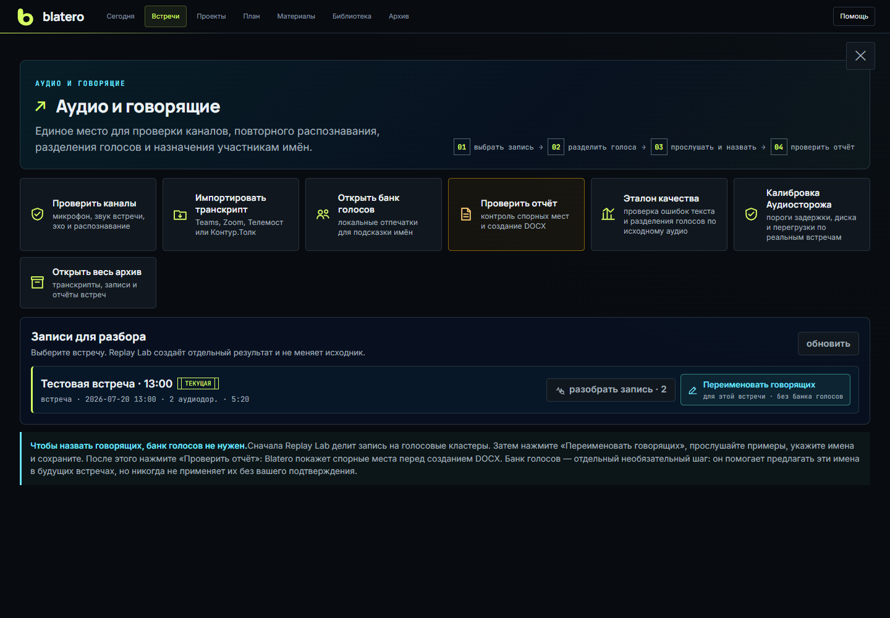
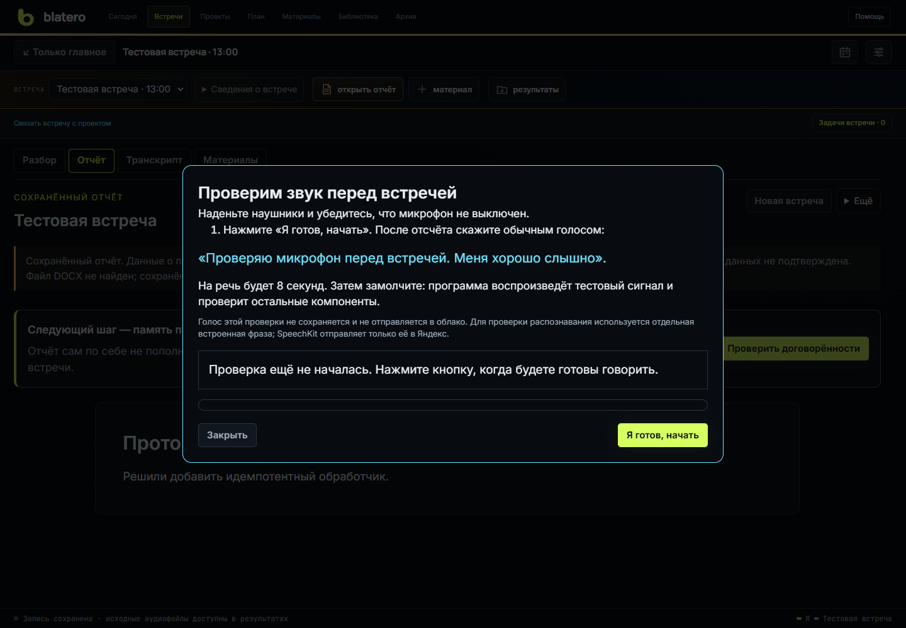
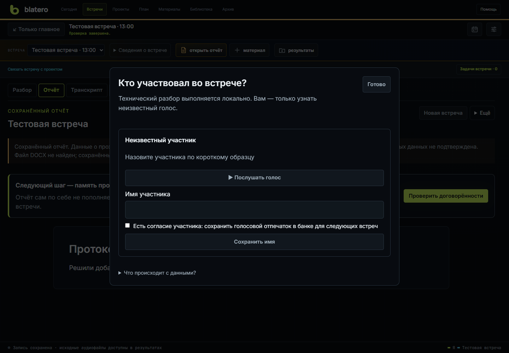

# Аудио и говорящие

Панель **«Настройки → Обслуживание → Аудио и говорящие»** объединяет проверку устройств,
Replay Lab, диаризацию, назначение имён, банк голосов, импорт и эталон качества.
Все операции над архивной записью создают производные данные и не изменяют
исходные WAV и живой JSONL.

## Почему двух каналов недостаточно для имён

Микрофон и системный звук отвечают на вопрос "из какого источника пришёл звук",
но не всегда "какой человек говорил". В системном канале может быть несколько
удалённых участников; микрофон может слышать коллегу в комнате и утечку из
наушников. Поэтому Blatero использует два независимых этапа:

1. во время звонка - надёжное разделение по физическому источнику;
2. после звонка - локальная диаризация голосовых кластеров и ручное назначение
   имён.

Автоматическое имя из банка голосов остаётся предложением и не применяется без
подтверждения.

## Проверка устройств

### «Проверить всё» перед встречей

1. Нажмите «Проверить всё». Устройства ещё не проверяются: сначала откроется
   инструкция. Наденьте наушники, проверьте, что микрофон не выключен.
2. Нажмите «Я готов, начать». После отсчёта 3–2–1 скажите обычным голосом:
   «Проверяю микрофон перед встречей. Меня хорошо слышно». На это даётся 8 секунд;
   уровень виден в том же окне. Закрытие окна во время отсчёта отменяет старт.
3. Затем замолчите для тестового сигнала. Программа проверит маршрут звука,
   совместный захват каналов как в настоящей записи, AEC, реальное распознавание
   встроенной синтетической фразы, LLM и доступность папки результатов.
4. Прочитайте результаты в том же окне. Если микрофон открылся, но речи не было
   или она слишком тихая, появится «Проверка голоса не завершена». Это не означает,
   что устройство сломано, и не даёт зелёную готовность. Нажмите «Повторить
   проверку» и произнесите фразу после отсчёта. Если говорили, но уровень не
   меняется, проверьте выбранный вход, mute и громкость микрофона в Windows.

Речь этой проверки не сохраняется и не отправляется в облако. Для теста STT
используется отдельная встроенная фраза; при SpeechKit только она отправляется
в Яндекс. Проверка не начинает запись встречи и недоступна во время REC.

### Микрофон

Выберите устройство и сохраните изменение. Нажмите **«Проверить микрофон»**,
дождитесь отсчёта 3–2–1 и надписи **«Говорите сейчас»**, затем произнесите
показанную фразу обычным голосом. Проба длится 12 секунд; рядом видны уровень
и оставшееся время. Прослушайте блок **«Ваша проба»**. Эта проверка не вызывает
STT и облако, не создаёт голосовой профиль и не пишет в папку встречи.
«Повторить» начинает новую пробу, «Удалить пробу» или закрытие окна освобождает
её из памяти вкладки. Для реального теста STT используйте **«Проверить всё»**.

Если браузер пишет "нет сигнала":

1. проверьте разрешение микрофона в Windows и браузере;
2. закройте приложение, которое захватило устройство в монопольном режиме;
3. выберите точное устройство вместо `auto`;
4. переподключите гарнитуру и обновите список;
5. скачайте диагностику - она не включает содержание записи.

Если два устройства имеют одинаковую системную подпись, Blatero добавляет к ним
номер устройства. Выбирайте строку с номером: старое простое имя с двумя
совпадениями отклоняется как неоднозначное. После отключения и повторного
подключения гарнитуры возвратившийся канал автоматически открывается заново;
разрыв остаётся виден в диагностике.

### Системный звук встречи

Выберите тот же выход, на который реально выводит звук приложение или браузер,
и включите тестовый звук. Отключение собственного микрофона в приложении
встречи не отключает локальный микрофон Blatero и не влияет на loopback: это
разные аудиомаршруты.

Если удалённые участники не слышны, чаще всего приложение использует другой
выход, Bluetooth переключился в hands-free профиль или Windows сменила default
после подключения устройства.

## Эхо и калибровка

Системная фраза может акустически попасть из наушников или колонок в микрофон.
Локальный AEC сравнивает оба потока и вычитает только уверенно совпавшую часть
до STT. Сырой микрофонный WAV остаётся исходным доказательством.

Калибровку выполняйте в тихой комнате с теми же устройствами и громкостью,
которые будут на встрече. Она становится устаревшей после смены микрофона,
выхода, backend или значимого изменения маршрута.

Backend:

- **авто** - WebRTC AEC3, если подготовлен, иначе встроенный корреляционный;
- **WebRTC AEC3** - потоковый вариант с безопасным откатом при ошибке;
- **встроенный** - не требует дополнительного бинарника.

Текстовая дедупликация - вторая страховка. Она убирает копию одной реплики из
микрофонного канала, если та же фраза уже уверенно распознана в системном.

## Replay Lab

Replay воспроизводит старую запись как эксперимент:

- выбирается WAV-дорожка и модель Whisper;
- включаются/выключаются AEC и разделение голосов;
- результат пишется в новый каталог `replay-runs`;
- исходные файлы остаются неизменными;
- прогон можно закрыть, отменить или продолжить в фоне.

Матрица Replay сравнивает варианты по длительности, числу реплик, совпадению с
опорным транскриптом, эхо-сигналам и диаризации. Кнопка принятия переносит только
выбранный производный вариант в проверку голосов, не заменяя живую запись.

Без подтверждённого эталона Replay не показывает BEST и не рекомендует вариант.
Можно только выбрать кандидатов для прослушивания. Raw confidence Whisper -
некалиброванная внутренняя вероятность слов, а не "точность" и не основание
сравнивать разные модели.

Временная шкала показывает исходный звук и подсвечивает реплику по timestamp.
Это удобнее списка коротких ссылок: можно услышать контекст до и после
сомнительного места.

## Разделение голосов и имена

1. Откройте Replay нужной встречи.
2. Выберите дорожку и включите разделение голосовых кластеров.
3. Укажите примерное число голосов, если оно известно.
4. После расчёта нажмите **"Переименовать говорящих"**.
5. Прослушайте несколько характерных фрагментов каждого кластера.
6. Объедините кластеры одного человека и разделите очевидно склеенную реплику.
7. Назначьте имена вручную или подтвердите предложение банка.

Не определяйте человека по одной короткой фразе, кашлю или шуму. Если кластер
содержит два голоса, сначала разделите спорную реплику; назначение имени всему
кластеру иначе испортит отчёт.

## Банк голосов

Профиль создаётся только после явного согласия и содержит имя, служебные
метаданные и несколько числовых embeddings. Исходная запись в профиль не
копируется. Образец можно переименовать, проверить одноразовой записью или
удалить целиком. Временный WAV проверки удаляется и при успехе, и при ошибке.

Банк полезен для знакомых интервьюеров и коллег. Ручная проверка всё равно
остаётся последним шагом. Голосовой отпечаток - биометрический признак;
создавайте его только при понятном основании и удаляйте, когда он больше не
нужен.

## Редактор транскрипта

Редактор работает с каноническими финальными событиями. Можно:

- найти реплику по тексту или говорящему;
- прослушать связанный фрагмент;
- исправить текст, время, канал и имя;
- разделить склеенную реплику;
- сохранить согласованно JSONL, Markdown и локальный audit trail.

Если другая вкладка уже изменила транскрипт, устаревшая версия получает
конфликт и не перезаписывает свежие данные. Ошибка рендера откатывает все
файлы, а не оставляет частично обновлённую сессию.

## Импорт внешнего транскрипта

Поддерживаются распространённые текстовые, subtitle, JSON и документные
выгрузки приложений встреч. Импорт определяется по содержимому и адаптеру, а не
по названию конкретного сервиса. Новый текст добавляется отдельным сегментом.

После импорта архив выбирает канонический содержательный журнал, а не файл с
исторически привычным именем. Неизвестный формат, слишком большой файл или
небезопасная структура отклоняются до записи в сессию.

## Эталон качества

Эталон превращает архивную встречу в ручную разметку для объективного сравнения
STT/AEC/диаризации. Подтверждённая разметка даёт WER, DER/JER, ошибку канала и
ложное подавление эха. До подтверждения правок встреча не участвует в общей
метрике.

Начальная цель - 10-20 разнообразных рабочих записей. Один удачный звонок не
доказывает качество для других гарнитур, помещений и числа участников.
Эталон жёстко связан с `recording_id`, сегментом, дорожкой и journal; чужая или
битая WAV-разметка не включается в WER/DER/JER. DER/JER публикуются с collar
250 мс.

## Короткая проверка участников после встречи

После остановки откройте **Участники и банк голосов → Автоматически найти голоса**.
Программа локально разделит голоса во всех записанных дорожках звука встречи
и сравнит их с банком. Для этого нужны установленные локальные модели;
при их отсутствии будет показано объяснение, а не пустой результат.

Неизвестные голоса показаны первыми. Прослушайте короткий образец, введите имя
и нажмите **Сохранить имя**. Предположения банка и уже названные участники
свёрнуты отдельно. Сходство голоса не доказывает личность: при сомнении проверьте
образец, а не принимайте имя автоматически.

Чтобы использовать образец в следующих локальных разборах, отдельно отметьте
наличие согласия участника на сохранение голосового отпечатка и нажмите
**Сохранить имя и голос в банк**. Без этой отметки банк не пополняется.
Наложенная и слишком короткая речь не используется для пополнения банка.

Этот маршрут не требует просмотра каждой фразы. Он не меняет исходные WAV,
транскрипты и готовый отчёт. Названные здесь голоса сохраняются в коротком
разборе; перенос имён на реплики и проверка ошибок группировки остаются
отдельной операцией подробного разбора. Распознавание участников в реальном
времени этим экраном не включается. Голосовые отпечатки удаляются отдельно
в настройках банка голосов.

## Что отправляется наружу

Replay, локальный Whisper, AEC, Sherpa-ONNX, редактор и банк голосов работают
локально. Yandex SpeechKit получает аудио только когда выбран как STT. LLM
получает очищенный текст, но не WAV, для подсказок/разбора при разрешённом
облачном маршруте. Подробности выбора провайдера и режима облака описаны на
странице **[Провайдеры и приватность](Privacy-and-Providers)**.
