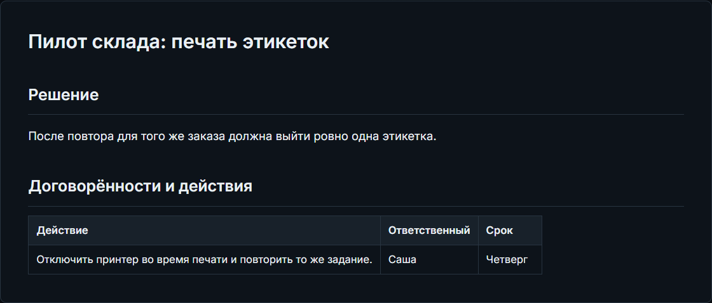
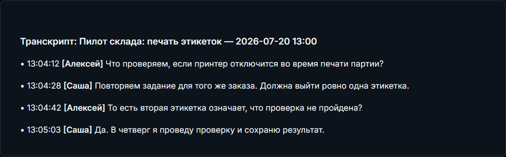
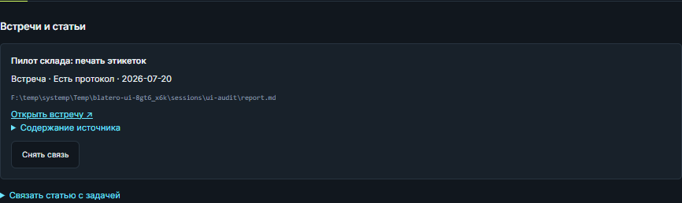

# Практический кейс: от решения на встрече до задачи

[English](en/Case-Meeting-to-Task.md) · [Справка Blatero](Home.md)

**Ситуация.** На пилоте склада принтер отключился посреди печати. На встрече
команда согласовала критерий: повтор задания для того же заказа должен дать
ровно одну этикетку. Нужно проверить, что это действительно прозвучало,
и оставить в существующей задаче ссылку на исходное обсуждение.

**Перед началом.** Нужны завершённая встреча с сохранёнными отчётом и транскриптом
и открытая задача в проекте. На снимках — вымышленная встреча «Пилот склада:
печать этикеток» и задача «Проверить повтор печати без дублей». Вместо них
можно использовать свою встречу и карточку. Повторно запускать запись,
генерировать отчёт или подключать ИИ для этих шагов не нужно.

## 1. Найдите в отчёте решение и действие

В разделе **«Встречи»** откройте завершённую встречу и вкладку **«Отчёт»**.
Разделите два пункта: **критерий** — одна этикетка на тот же заказ после
повтора; **действие** — отключить принтер во время печати и повторить задание.
В учебном отчёте за действие отвечает Саша, срок — четверг.

## 2. Проверьте формулировку по транскрипту

На вкладке **«Транскрипт»** найдите фразы «Повторяем задание для того же
заказа» и «Должна выйти ровно одна этикетка». Следующая реплика уточняет,
что вторая этикетка означает провал проверки. Это условие приёмки, а не
подтверждение того, что проверка уже прошла. Если имя или формулировка
сомнительны, прослушайте отрезок через
[«Аудио и говорящие»](Audio-and-Speakers.md).

## 3. Свяжите встречу с карточкой

Нажмите **«Задачи встречи»**. Выберите проект, затем в списке существующих
задач — **«Проверить повтор печати без дублей»**. Нажмите
**«Связать с выбранной задачей»**. Карточка появится среди связанных.
Откройте её: в разделе **«Встречи и статьи»** появится источник с названием
встречи и ссылкой обратно. По ней можно вернуться к отчёту и транскрипту.

**Что должно получиться.** В карточке есть ссылка на встречу, а во встрече —
ссылка на карточку. Статус задачи, отчёт и транскрипт остались прежними.
Если в задаче ещё не указан следующий шаг, внесите его в карточку отдельно.
Если задачи пока нет, в том же окне есть действие **«Создать карточку встречи»**.
Память проекта — отдельный шаг: её пополняют подтверждённые пункты из
[разбора отчёта](Reports-and-Archive.md).
