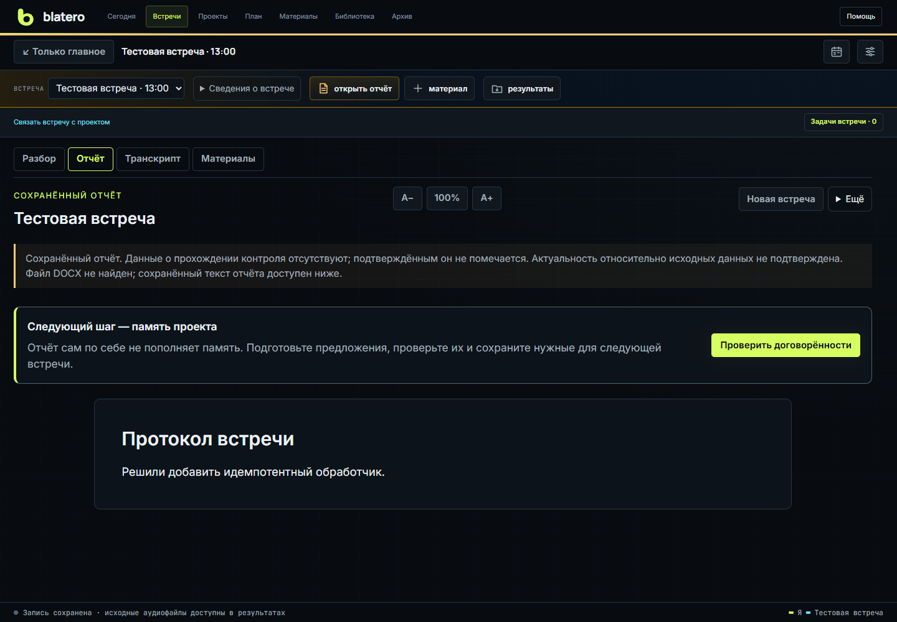

# Blatero

> Справка сверена с интерфейсом 1 ноября 2026 года. Версия запущенного сервера может отличаться от версии распакованного пакета.

[English help](en/Home.md)

Локальное пространство встреч, рабочих задач и знаний. Встречи сохраняют
раздельные аудиоканалы, транскрипт, подсказки и проверяемый отчёт. Проекты
сохраняют цель задачи, выбранный метод, основания и следующий шаг.

В общей навигации доступны «Сегодня», встречи, проекты, план, материалы, библиотека и архив. «Задачи встречи» связывают запись с карточками и основаниями решений; обратная ссылка возвращает к исходной встрече. Подробнее — [Проекты и задачи](Projects) и [Библиотека знаний](Knowledge-Library).

Blatero не привязан к конкретному сервису связи: он работает с выбранными
микрофоном и системным выходом любого приложения встречи или браузера.

Видеозапись экрана или неактивного окна — [отдельная опция](Video-Recording).
Видео сохраняется локально; аудио остаётся в отдельных WAV.

## С чего начать

Откройте **«Помощь»** в общей шапке. На доске и экране встречи доступны три
маршрута: **«Провести встречу»**, **«Вести задачи»**, **«План и закрепление»**.
Пошаговый обзор — [Единое пространство: быстрый старт](Workspace-Quickstart).
Для ведения задач запись встречи и обращение к модели не нужны.

Практический кейс: [сверить решение по транскрипту и связать встречу с задачей](Case-Meeting-to-Task.md).

На главном экране путь показан четырьмя карточками:
**подготовить -> проверить -> записать -> разобрать**. Обновлённая стартовая
инструкция показывается при запуске, пока включена галочка «Показывать обучение
при запуске». Закрытие инструкции не снимает галочку. Начните с кнопки
**«Открыть настройки»**: обзор показывает звук, доступ к ИИ и передачу данных.
Подробности — [Справочник настроек](Settings-Reference).

1. Откройте **«Настройки»**: выберите микрофон, выход звука встречи и
   распознавание. Для подсказок и отчёта настройте подключение ИИ.
2. Нажмите **«Новая встреча»**. Можно указать только тему либо выбрать проект,
   задачи и время, затем локально подтянуть материалы и прошлые договорённости.
3. Выполните **«Проверить всё»**. Нажмите «Я готов, начать» и говорите после
   отсчёта; затем замолчите для тестового сигнала.
4. В меню **«Запись»** выберите аудио, аудио с экраном или аудио с окном.
   Видео требует выбора источника и предпросмотра. Рабочая запись требует
   подтверждения уведомления участников или другого основания.
5. После **«Стоп»** нажмите **«Завершить и создать отчёт»**. Подробный разбор
   фраз необязателен; проверяйте участников и спорные места по необходимости.
6. Проверьте выводы, создайте DOCX и откройте **«Проверить договорённости»**.
   Только выбранные и подтверждённые пункты станут памятью следующей встречи.

Для пробных записей выберите тестовый контур в параметрах встречи. Исходная
запись сохраняется отдельно от разборов; смена STT не останавливает WAV.

Подробности: **[руководство пользователя](User-Guide)**. Если термин незнаком,
откройте **[словарь простыми словами](Glossary)**.

## Быстрые ссылки

- [Единое пространство: задачи, встречи и закрепление](Workspace-Quickstart)
- [Проекты, агенты и учет затрат](Projects)
- [Общая библиотека знаний](Knowledge-Library)
- [Создать и подготовить встречу](Meetings-and-Preparation)
- [Процессы от начала до конца](End-to-End-Processes)
- [Запись, подсказки и история](Live-Meeting)
- [Проверка звука, Replay и говорящие](Audio-and-Speakers)
- [Тренировка и сценка AI x AI](Training)
- [Проверить и создать отчёт](Reports-and-Archive)
- [Подключить LLM и выбрать приватность](Privacy-and-Providers)
- [Создать ключи и проверить провайдеров](Provider-Setup)
- [Правила записи и пилотного использования](Recording-and-Policy)
- [Пилотное тестирование](Pilot-Testing)
- [Все поля настроек](Settings-Reference)
- [Решить проблему](Troubleshooting)

## Карта документации

| Задача | Страница |
|---|---|
| Начать с задачи, плана или собственного пересказа | [Единое пространство](Workspace-Quickstart) |
| Вести карточки агентами и связать результат со встречей | [Проекты и задачи](Projects) |
| Первый запуск и обновление | [Установка, модели и восстановление](Installation-Recovery-Updates) |
| Настоящее интервью или консультация | [Новая встреча](Meetings-and-Preparation) -> [Живая встреча](Live-Meeting) |
| Понять весь путь целиком | [Процессы от начала до конца](End-to-End-Processes) |
| Проверка старой записи | [Аудио и говорящие](Audio-and-Speakers) |
| Подготовка к собственному собеседованию | [Тренировочный центр](Training): свободная роль или готовый профиль компетенций |
| Память между встречами | [Календарь и память](Calendar-and-Memory) |
| Непонятная настройка | [Справочник настроек](Settings-Reference) |
| Нужно настроить OpenRouter, Codex, OpenAI или Yandex | [Подключение провайдеров](Provider-Setup) |
| Приватность, облако и промпты | [Провайдеры и приватность](Privacy-and-Providers) |
| Передать сборку коллеге или начать рабочую запись | [Запись и правила пилота](Recording-and-Policy) |
| Собрать обратную связь от первого тестировщика | [Пилотное тестирование](Pilot-Testing) |
| Ошибка или странный результат | [Диагностика](Troubleshooting) |
