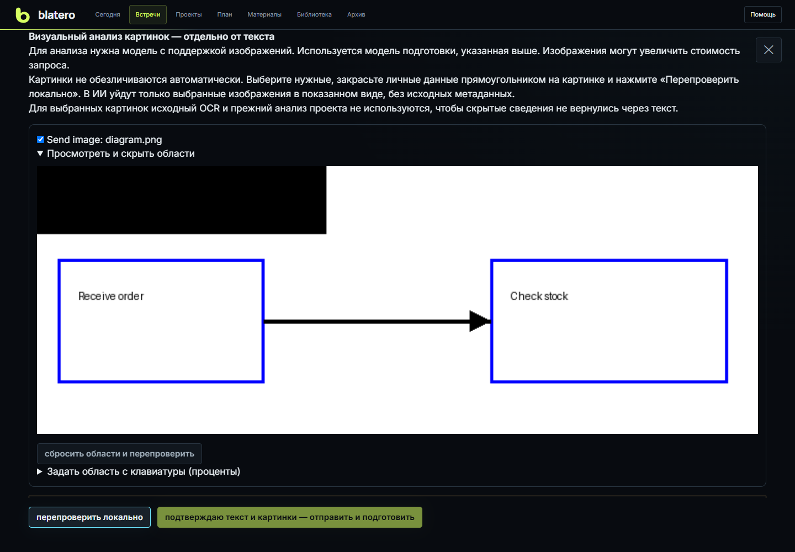

# Новая встреча и подготовка

Blatero создаёт отдельную сессию до начала записи. Это важно: тип встречи,
материалы, рабочая папка и вопросы можно проверить без доступа к микрофону и без
риска записать пробный звук в рабочий архив.

## Какой тип выбрать

| Режим | Кто вы | Что показывает подсказка | Что будет в отчёте |
|---|---|---|---|
| Я интервьюирую | интервьюер | следующий вопрос, что уточнить, фактические противоречия | вердикт, рубрика, сильные стороны, риски, непроверенное |
| Я прохожу собеседование | кандидат | короткий корректный ответ на последний вопрос, понятия и возможная поправка | вопрос, ваш ответ, правильный ответ, ошибки и план повторения |
| Тренировка | кандидат в учебной сессии | структура ответа и дозированная подсказка | оценка работодателя, правильные ответы, самостоятельность, карта компетенций |
| Консалтинг | консультант | боль, вопрос клиенту, риск, договорённость | запросы, решения, действия, сроки, follow-up |
| Другая встреча | участник | нейтральный следующий шаг и незакрытые договорённости | протокол, решения, действия и открытые вопросы |

Тип нельзя менять во время записи. Иначе роли "Я" и "Собеседник" могли бы
перевернуться посреди транскрипта и отчёта.

## Рабочий и тестовый контуры

**Рабочий** предназначен для настоящих звонков. **Тестовый** - для настройки
микрофона, пробных записей, Replay-экспериментов и обучения интерфейсу. Тестовый
контур постоянно помечен `TEST` и отделён в архиве, памяти и локальных метриках.

Практическое правило: если результат может войти в решение о человеке, клиенте
или проекте, создавайте рабочую встречу. Проверку нового движка выполняйте в
тестовой.

## Четыре шага мастера

### 1. Формат

Выберите роль из таблицы выше. От неё зависят не только подписи, но и системный
промпт, SIM, порядок начала сценки и структура финального документа.

### 2. Цель

Заполните:

- имя или название встречи;
- ожидаемую длительность - это ориентир для подсказки, а не таймер остановки;
- клиента/компанию и проект - ключи общей памяти;
- цель, роль, вакансию, темы или обязательные вопросы.

Не вставляйте API-ключи и пароли. Резюме, вакансию или техническое задание можно
поместить в текстовое поле, положить в рабочую папку либо добавить ссылкой в
тренировочном центре.

### 3. Материалы и рабочая папка

Кнопка **"выбрать папку"** открывает системный диалог. **"Проверить путь"**
выполняет только локальную проверку. Если включена ИИ-подготовка, сначала
происходит локальная проверка:

- исключаются `.git`, зависимости, кэши, бинарники и большие файлы;
- файлы с вероятными секретами и структурированными персональными данными не
  отправляются модели;
- для повторного анализа считается diff относительно предыдущего снимка;
- при пустой или бессодержательной папке LLM не вызывается, а интерфейс прямо
  сообщает о нехватке данных.

Поддерживаются материалы во вложенных папках:

| Формат | Что читается |
| --- | --- |
| DOCX, ODT | Абзацы и текст таблиц |
| PDF | Текстовый слой, не более 100 страниц |
| XLSX | Текст и значения ячеек; формулы и сохранённый результат, без пересчёта |
| PPTX | Текст слайдов, без анализа их оформления |
| DOC, XLS, PPT, RTF | Локальная конвертация через LibreOffice, затем чтение текста |
| Draw.io | Блоки, подписи, связи и страницы, включая сжатые файлы |
| BPMN, BPMN2 | Элементы процесса, потоки, условия и дорожки |
| Visio VSDX, VDX | Фигуры, подписи и доступные точки соединений; шаблоны фигур могут быть неполными |
| Visio VSD | Конвертация LibreOffice в FODG; часть свойств исходной схемы может потеряться |
| SVG | Надписи и геометрия, явные ссылки между элементами; встроенная схема Draw.io, если она есть |
| ODG, FODG | Страницы, подписи фигур и доступные связи |
| PNG, JPEG, BMP, TIFF | Локальный OCR; по отдельному выбору — визуальный анализ в ИИ |
| TXT, Markdown, CSV, TSV и исходники | Текст; поддерживается также UTF-16 с меткой кодировки |

Word не нужен. LibreOffice требуется только для старых DOC/XLS/PPT/RTF/VSD;
для остальных перечисленных форматов он не нужен. Исходные материалы не изменяются.
Конвертация работает с временной копией и отдельным профилем с отключёнными
макросами и активным содержимым. Это не полноценная системная песочница:
подозрительные файлы не следует открывать даже через конвертер.
Документы с признаками внешних ссылок отклоняются; их нужно пересохранить
локально в современный формат. Возможны ложные срабатывания этой защиты.
В результате проверки раскройте **«Состав материалов»**: там указано, что
прочитано, что взято частично, а что пропущено и как это исправить.

Распознавание изображений требует Windows 10/11 и установленного языкового
компонента OCR. Используется русский язык, если он доступен; иначе — язык
профиля Windows. Если компонента нет, программа сообщает об этом и продолжает
читать другие файлы. По умолчанию в подготовке используется только извлечённый
текст. Сами картинки отправляются исключительно после отдельного выбора и
подтверждения, описанных ниже; этот режим не требует OCR Windows.

**OCR не понимает смысл фотографии или схемы.** Он читает только надписи и
может ошибаться. Встроенные картинки в документах и PDF-сканы без текстового
слоя пока нужно сохранить отдельными PNG/JPEG. Многостраничный TIFF разделите
на отдельные изображения. Архивы автоматически не распаковываются. Бинарные обработки
`.epf` не анализируются как исходный код; аудио и видео разбираются в разделе
разбора записи, а не при проверке рабочей папки.

Для документов и изображений действует предел 10 МБ на файл; для офисных
ZIP-контейнеров — 20 МБ на распакованное содержимое.
Из каждого выбранного файла берётся до 12 000 символов, из всей папки — до
120 000 символов. Повреждённые или слишком большие документы пропускаются
с объяснением в результате проверки; остальные материалы продолжают читаться.
Временные файлы открытых документов Word (`~$…`) не учитываются.
За одну проверку распознаётся не более восьми изображений, до 15 секунд на
одно. После 45 секунд суммарной работы OCR новые изображения не запускаются;
последнее начатое распознавание может завершиться позже. Для больших подборок
выбирайте папки меньшего размера. Изображения больше 20 миллионов пикселей
или предела OCR Windows нужно уменьшить либо разделить.
Старые документы конвертируются не более восьми за проверку, до 45 секунд на
файл; после 90 секунд суммарной конвертации новые файлы не запускаются.

Схемы не исполняются: скрипты SVG, макросы и внешние ссылки не используются
как команды. У обычного SVG может не быть сведений о том, какие блоки соединяет
стрелка. В этом случае извлекается геометрия, а не выдуманный граф связей.
Для наглядного анализа такой SVG можно дополнительно экспортировать в PNG.

Сформированный вопрос должен содержать сам вопрос, ожидаемый ответ и связь с
конкретным материалом. Источник показывается как относительный файл, без
публикации абсолютного пути.

### 4. Проверка

Мастер показывает итог: контур, роль, участника, длительность, материалы и
состояние папки. **"Создать и подготовить"** создаёт сессию, но не включает
микрофон. После этого выполните **"Проверить всё"**.

### Перед отправкой материалов в ИИ

Если выбрана подготовка по рабочей папке, после локального разбора открывается
**«Что уйдёт в облако»**. До подтверждения этой страницы облачный анализ папки
не запускается. То же правило действует для повторной подготовки из настроек.

1. Проверьте получателя и модель, указанные над текстом.
2. Слева снимите галочки с файлов, которые нельзя отправлять. В поле
   **«Дополнительно скрыть»** можно вписать имена, названия или другие фрагменты,
   каждый с новой строки. Исходные документы не меняются.
3. После изменения выбора нажмите **«Перепроверить локально»**. При исключении
   файлов прежний анализ проекта не используется: он мог содержать их сведения.
4. Справа прочитайте точный текст отправки. Системная инструкция раскрывается
   отдельно. Слева можно раскрыть исходный запрос с подсветкой подозрительных
   фрагментов; он показывается только на этом компьютере.
5. Нажмите **«Подтверждаю текст — отправить и подготовить»**. Крестик отменяет
   ожидающую отправку. Закрытие страницы само по себе ничего не отправляет.

Проверка использует локальную модель Natasha для русского текста и правила
поиска контактов, документов и секретов. Она применяется и к тексту, извлечённому
из изображений. Названия файлов заменяются служебными обозначениями; ссылки
на них восстанавливаются в результате локально. Одинаковое написание имени
получает одинаковую замену в одном запросе; разные падежи могут получить разные
обозначения. Иностранные имена, ошибки OCR и косвенные признаки личности могут
быть пропущены. Это проверка риска, а не гарантия полной анонимности.

### Визуальный анализ схем и картинок

На странице **«Что уйдёт в облако»** ниже текста находится раздел
**«Визуальный анализ картинок»**. Изображения по умолчанию не выбраны.

1. Убедитесь, что выбранная в настройках модель подготовки поддерживает изображения.
   Доступны подключения Codex, OpenRouter, OpenAI, Anthropic и совместимый API.
   Для Codex нужен установленный CLI с поддержкой `codex exec --image` и вход
   через `codex login`. Blatero передаёт подготовленные PNG как вложения,
   без включения инструментов, и удаляет временные копии после завершения запроса.
   Отдельный API-ключ для этого подключения не требуется. В прямом DeepSeek
   этот режим пока недоступен; текстовая подготовка продолжает работать.
2. Отметьте **«Отправить картинку»** у нужных файлов и раскройте просмотр.
3. Скройте чувствительные области: протяните мышью прямоугольник на картинке.
   С клавиатуры можно задать положение и размер области в процентах.
   Для отмены закрашивания нажмите **«Сбросить области и перепроверить»**.
4. Нажмите **«Перепроверить локально»** и внимательно посмотрите полученные картинки.
   Текстовая проверка персональных данных не обезличивает пиксели автоматически.
5. Отметьте отдельную галочку разрешения отправить проверенные картинки.
   Затем подтвердите подготовку. До этого запрос в ИИ не выполняется.

Перед отправкой создаётся PNG без исходных метаданных, длинная сторона — не
более 1600 пикселей. Чёрные области записываются в сами пиксели, а не накладываются
поверх исходника только в браузере. Доступно до восьми изображений, до 40 областей
скрытия на каждом. Мелкие надписи после уменьшения могут стать нечитаемыми;
крупную схему лучше заранее разделить. Изменение исходной картинки отменяет
подтверждение, даже если её распознанный текст остался прежним.
При выборе картинок исходный OCR этих файлов и прежний анализ проекта не
включаются в запрос: иначе закрашенные сведения могли бы попасть в ИИ как текст.

Анализ поступает в общий контекст проекта и вопросы к встрече. Качество зависит
от модели; неоднозначные стрелки и подписи требуют проверки человеком.
Картинки могут увеличить стоимость запроса. Здесь анализируются отдельные
файлы изображений — не встроенные иллюстрации Word/PowerPoint и не страницы PDF.

Подтверждение действует 15 минут, используется один раз и относится к конкретной
версии запроса. Если изменились файлы, цель, прошлый контекст, модель или
получатель, потребуется новый просмотр. При ошибке локального детектора отправка
блокируется. Для повторного начала нажмите подготовку рабочей папки в настройках.
Предпросмотр не сохраняется отдельным файлом: ожидающее разрешение находится
в памяти сервера и становится недействительным после отмены, смены встречи,
перезапуска или истечения срока. Облачное согласие настраивается отдельно.

**Область действия:** этот контроль относится к подготовке по рабочей папке.
Для оперативных подсказок, отчётов и тренировок сохраняется прежний фильтр;
отдельное подтверждение каждого такого запроса здесь ещё не реализовано.

Если ИИ или основание облачной обработки не настроены, мастер не сбрасывает
заполненные поля. На шаге проверки доступны три прямых действия: открыть
настройку ИИ, открыть приватность или создать встречу без ИИ-подготовки.

## Подготовка по папке кандидата

Для интервью полезно хранить материалы в отдельной папке: резюме, описание
вакансии, заметки и разрешённые примеры кода. Если папки организованы по
фамилиям, Blatero может найти подходящую по имени участника. Автопоиск - только
подсказка: перед встречей проверьте, что открыта папка нужного человека.

Результат подготовки включает:

- краткое досье только по найденным материалам;
- список фактов, которые стоит подтвердить;
- вопросы подходящего уровня и короткие практические задачи;
- правильные ответы и признаки сильного/слабого ответа;
- явное предупреждение, если материала недостаточно.

## Что делать, если подготовка не удалась

1. Нажмите **"проверить введённый путь"** и исправьте путь.
2. Проверьте LLM через **Настройки -> ИИ и автоматизация**.
3. Если выбран облачный маршрут, подтвердите его в **Приватность**.
4. Убедитесь, что в папке есть текстовые материалы, а не только бинарники.
5. Подготовьте встречу вручную: запись и локальное распознавание не должны
   блокироваться из-за отсутствия ИИ-контекста.

## Подтверждение перед рабочей записью

Перед рабочей записью нужно отметить: участники уведомлены о записи либо у
оператора есть иное применимое основание. Без отметки команда блокируется и в
браузере, и на сервере. Локально сохраняется время statement.

Это не автоматическое распознавание согласия и не юридическая консультация.
Cloud ack, запись разговора и согласие на голосовой отпечаток - три разные цели
и три разные границы.

## Календарное событие и сессия

Событие в календаре - это расписание, а сессия - каталог рабочих данных. При
подготовке из события проверьте тип встречи, имя, компанию и материалы: текст
календаря может быть неполным. Подробнее - **[Календарь и память](Calendar-and-Memory)**.
