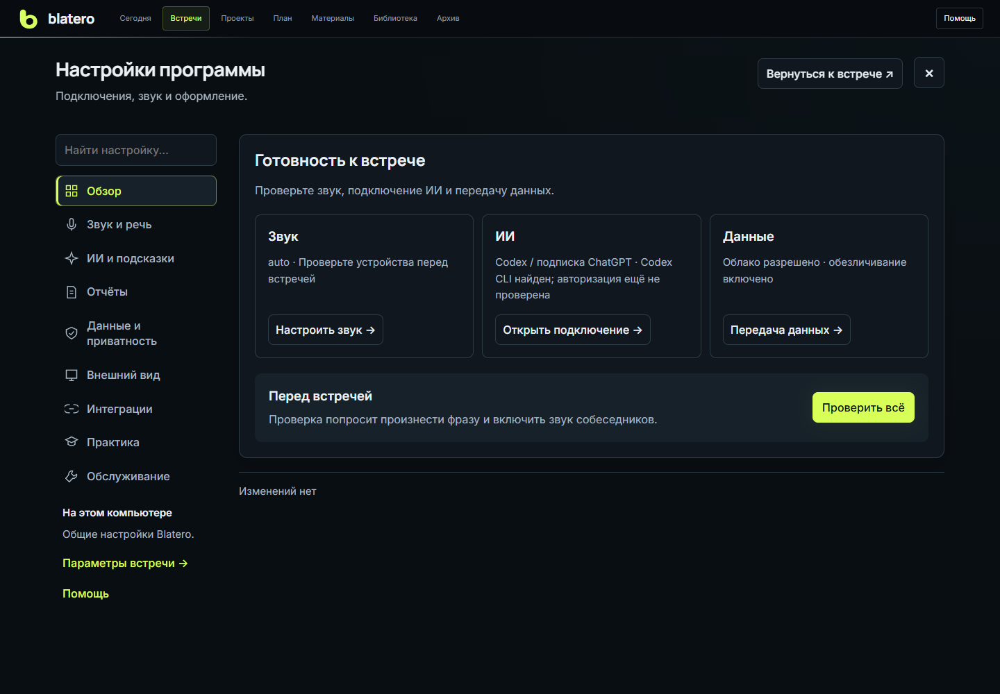
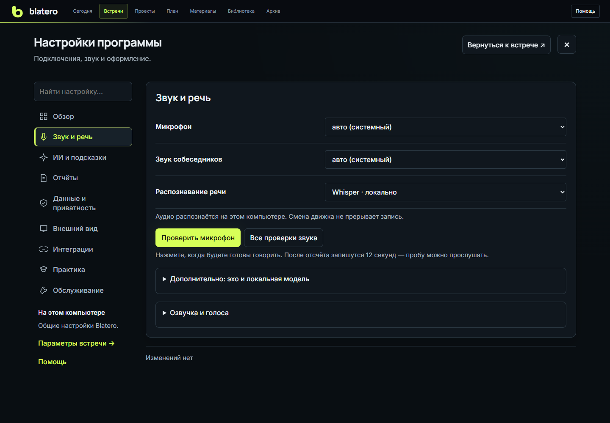

# Справочник настроек

С версии 1.0.0-rc.16 настройки открываются обзором готовности. Слева — меню
и поиск; на узком экране — список разделов. Дополнительные параметры раскрываются
внутри раздела. Общего переключателя «Простые / Подробные» больше нет.

Разделы: **Обзор**, **Звук и речь**, **ИИ и подсказки**, **Отчёты**,
**Данные и приватность**, **Внешний вид**, **Интеграции**, **Практика**, **Обслуживание**.
Параметры выбранной встречи открываются отдельно по ссылке под меню или через
мобильный список. Кнопка **«Вернуться к встрече»** находится вверху окна.

## Сохранение и область действия

Поля программы и встречи сначала меняются в черновике этой вкладки. Кнопки
**«Сохранить изменения»** и **«Отменить изменения»** относятся к текущему разделу.
Переход между разделами не стирает ввод. Надпись **«Сохранено сервером»**
появляется только после подтверждения записи.

Изменённые поля выделяются, рядом с разделом показано число изменений.
На узком экране это число есть в списке разделов. **«Перейти к изменениям»**
открывает первое изменённое поле; команда ничего не сохраняет и не отправляет.

При конфликте с другим окном, ошибке или потере связи черновик остаётся.
Проверьте значения и повторите сохранение. При закрытии можно сохранить
изменения, отбросить их или продолжить настройку. Черновик не записывается
на диск и не заменяет сохранение. Браузер предупреждает при закрытии вкладки.

Исключения:

- Тема, анимация и вид панелей применяются сразу в этом браузере. Размер текста
  можно предварительно посмотреть; общая настройка сохраняется кнопкой внизу.
- Сохранение подключения и успешная проверка соединения отдельно сохраняют
  выбранный доступ к ИИ. Проверка не отправляет материалы встречи.
- Проверка звука, калибровка, подготовка контекста, установка и удаление —
  отдельные команды. Перед проверкой или подготовкой сохраните параметры раздела.

## Перед первой встречей

Обзор показывает выбранный звук, наличие доступа к ИИ и передачу данных.
«Доступ настроен» не означает, что соединение проверено: проверка находится
в разделе ИИ. Нажмите **«Проверить всё»** и следуйте инструкции: когда произнести
фразу и когда включить звук собеседников.

### Обучение при запуске

Общая кнопка **«Помощь»** доступна на встрече и доске. В ней три маршрута:
встреча, задачи, план и закрепление. На доске инструкция открывается вручную;
галочка ниже управляет автоматическим показом на экране встречи.

Вверху инструкции находится галочка **«Показывать обучение при запуске»**.
По умолчанию она включена: инструкция появляется при новом открытии или
перезагрузке страницы, но не повторяется при каждом переходе внутри программы.
Крестик, кнопка перехода к главному экрану и переходы в настройки не снимают
галочку. Во время записи обучение автоматически не открывается.

Чтобы отключить показ, снимите галочку. Выбор сохраняется сразу, отдельно
в каждом браузере. Чтобы включить обратно, откройте **«Помощь»** и поставьте
галочку. Если браузер запрещает сохранение, под ней появится предупреждение.

## Параметры встречи

| Поле | Что делает | Важно знать |
|---|---|---|
| Контур данных | Относит сессию к рабочим или тестовым | Архив, память и метрики фильтруются по контуру. Для настоящих звонков выбирайте "Рабочий" |
| Формат и роль | Меняет роли, подсказки, эмуляцию и структуру отчёта | Варианты: "Я интервьюирую", "Я прохожу собеседование", "Тренировка", "Консалтинг", "Другая встреча" |
| Длительность | Даёт ИИ ориентир по оставшемуся времени | Не останавливает запись автоматически; `без лимита` отключает подсказки по таймингу |
| Тема встречи / имя участника | Название сессии и основа имени отчёта | Исправьте до DOCX, если распознавание имени ошиблось |
| Клиент / компания | Ключ общей памяти между встречами | Одинаковое нормализованное имя связывает контекст клиента |
| Роль бота | От чьего имени отвечает бот в эмуляции | Если пусто, роль берётся из типа встречи: кандидат, интервьюер, клиент или собеседник |

В раскрытии находятся контур, роль бота и подписи каналов «Я» и «Собеседник».
Тип встречи и контур нельзя менять во время записи.

Действия встречи:

- **Новая встреча** открывает четырёхшаговый мастер и не начинает запись.
- **Импорт транскрипта** добавляет внешнюю текстовую выгрузку новым сегментом;
  существующий живой транскрипт не перезаписывается.
Очистка результатов вынесена в **«Обслуживание → Восстановление и удаление данных»**.
Она удаляет аудио, транскрипт, подсказки, отчёт и отметки вопросов текущей встречи;
резюме, досье и сценарий остаются. Во время записи или фоновой обработки очистка
заблокирована.

### Материалы встречи

| Поле или кнопка | Что делает | Результат |
|---|---|---|
| Название проекта | Задаёт явный ключ памяти проекта | Если пусто, используется имя рабочей папки |
| Рабочая папка | Абсолютный путь к локальному коду и материалам | Путь остаётся локальным; в облако не отправляется |
| Выбрать папку | Открывает системный диалог Windows | Путь проверяется и попадает в черновик, но не сохраняется до команды пользователя |
| Проверить введённый путь | Проверяет существование, тип и доступность без LLM | Пустая или недоступная папка не выдаётся за подготовленную |
| Подготовить контекст | Делает локальный снимок, diff и затем ИИ-выжимку | Секреты, бинарники, зависимости и служебные каталоги исключаются до LLM |

Перед подготовкой сохраните параметры встречи. Перед отправкой откроется
проверка текста и изображений. Если информации недостаточно, Blatero показывает
это как предупреждение и не
выдумывает контекст. Повторный анализ передаёт модели изменения плюс прежнюю
карту, а не весь проект без необходимости.

## Звук и речь

| Настройка | Варианты и смысл | По умолчанию |
|---|---|---|
| Микрофон | Физический или виртуальный вход вашего канала | системное устройство |
| Звук приложения встречи | WASAPI loopback выбранного выхода | системный выход |
| Движок очистки эха | `авто`: WebRTC AEC3, затем встроенный; `WebRTC`; `встроенный` | авто |
| Вопросы голосом | свой локальный голос; свой голос с резервом Яндекса; только Яндекс | свой голос -> Яндекс |
| Голос эмуляции / резерв | filipp, alena, jane, ermil, zahar, omazh | auto / filipp |
| Убирать акустическое эхо | Вычитает совпавший системный сигнал из микрофона до STT | включено |
| Убирать текстовый дубль | Удаляет повтор одной фразы, распознанной в обоих каналах | включено |

Основные поля — микрофон, звук собеседников и распознавание. В дополнительном
раскрытии находятся локальная модель, эхо и калибровка, в «Озвучка и голоса» —
выбор голосов, их проверка и банк. Подписи каналов перенесены в параметры встречи.
Клонирование голоса не нужно для проверки микрофона.

### Проверить свой микрофон

1. Выберите микрофон и сохраните изменение.
2. Нажмите **«Проверить микрофон»**. Проверка откроется и начнёт отсчёт 3–2–1.
3. После надписи **«Говорите сейчас»** произнесите фразу, показанную на экране.
   Захват длится 12 секунд; рядом видны уровень и оставшееся время.
4. Нажмите воспроизведение в блоке **«Ваша проба»**. Убедитесь, что слышен ваш
   голос, а не только шум. Наличие сигнала само по себе не подтверждает речь.

**«Отменить»** прекращает отсчёт или текущую проверку. **«Повторить проверку»**
запускает новую пробу, **«Удалить пробу»** освобождает её из памяти вкладки.
Закрытие окна также удаляет пробу. Она не записывается в папку встречи,
не создаёт голосовой профиль и не передаётся в облако. Во время REC проверка
недоступна — используйте индикаторы записи.

Гарнитура не обязательна: с колонками можно проверить микрофон и прослушать себя.
Для проверки системного звука и эха используйте **«Все проверки звука»**.

| Настройка | Варианты | По умолчанию |
|---|---|---|
| Распознавание | локальный Whisper; Яндекс SpeechKit | локальный Whisper |
| Локальная модель | base, small, medium | small |

Акустический фильтр не меняет исходный микрофонный WAV. Его результат влияет на
распознавание и хранится отдельно в диагностических/Replay-артефактах.
Физическое устройство можно переподключить отдельно; при этом возможна короткая
пауза самого устройства. Смена движка распознавания не переоткрывает устройства
и не прерывает WAV. Для живого переключения используйте отдельную кнопку
**«Переключить движок»** или **«Применить модель»**. Они не смешивают смену STT
с остальными правками. При отказе подготовки прежний движок остаётся активным.

Кнопки **"проверка звука"**, **"калибровать эхо"**, **"установить WebRTC
AEC3"**, **"голос"** и **"банк голосов"** описаны на странице
**[Аудио и говорящие](Audio-and-Speakers)**.

## ИИ и подсказки

| Настройка | Что делает | Рекомендация |
|---|---|---|
| Автоподсказки | Выкл.; по смысловым паузам; каждые 30/60/90 секунд | "по паузам" для живой встречи |
| LLM | OpenRouter, Codex/подписка ChatGPT, OpenAI, Anthropic, DeepSeek, Ollama/совместимый API | Выберите фактически доступный маршрут |
| Подсказки | Быстрая модель для короткого ответа во время встречи | Быстрее важнее глубины |
| Отчёт / анализ | Модель для подготовки, отчётов, Replay и тренировок | Можно выбрать более сильную модель |
| API-токен | Секрет прямого API-провайдера | Сохраняется в Windows Credential Manager |
| Base URL | Endpoint Ollama, LM Studio, vLLM или другого OpenAI-compatible сервера | `http://127.0.0.1:11434/v1` |

Адрес совместимого API виден сразу при выборе этого подключения. В раскрытии
«Дополнительно» — модели, стиль вопросов и редактор системных инструкций.
Стиль применяется к следующей генерации. Системные инструкции можно сбросить
к стандартным; защитные правила приватности и ролей ими не отключаются.

**Сохранить подключение** записывает параметры и секрет в защищённое системное
хранилище. **Проверить соединение** посылает минимальный технический запрос без
транскрипта и файлов. Успешная проверка также сохраняет подключение.
При отказе введённый токен остаётся для исправления. **Удалить токен** убирает
секрет выбранного провайдера; другие источники доступа могут остаться.

Codex использует вход по подписке и не показывает поле API-токена. В этом
маршруте выполните `codex login`, затем проверьте соединение. Инструменты агента отключены: транскрипт не превращается в команду на
чтение файлов. У совместимого endpoint адрес loopback считается локальным;
внешний HTTPS-адрес - облачным и требует ручного разрешения.

## Внешний вид

| Настройка | Варианты | По умолчанию / действие |
|---|---|---|
| Размер текста | 90%, 100%, 115%, 130% | 115% |
| Рабочий вид | текущий, обычный, фокус, разбор | выбор хранится в браузере |
| Ширина сценария | 320-900 px | 620 px в обычном виде |
| Сценарий справа | Показывает или скрывает правую колонку | `Ctrl+B` переключает |
| История транскрипта | Показывает текстовую ленту | `Ctrl+J` переключает |
| Крупная история | Увеличивает высоту ленты для разбора | включается пресетом "разбор" |

Режим фокуса оставляет Аудиосторож, волну и управление записью, но освобождает
место от сценария и текста истории. **Обычный вид** возвращает панели
и базовую ширину.

Тема и анимация используют общий механизм пространства. Системное уменьшение
движения имеет приоритет. Вид панелей и тема сохраняются сразу в этом браузере.
Размер текста сначала применяется как предпросмотр; сохраните его кнопкой внизу.

## Отчёты

- **Показывать черновик перед DOCX** — включено. Позволяет исправить выводы
  локально без повторного запроса к модели.
- **Добавлять таймкоды и ссылки** — выключено по умолчанию. Добавляет переходы
  к моментам записи через `evidence.html`.

Изменения действуют для новых отчётов. Сохранённые документы не меняются.

## Данные и приватность

| Настройка | Варианты | По умолчанию |
|---|---|---|
| Текст для LLM | обезличивать; передавать исходный | обезличивать |
| Согласие получено | Ручное разрешение облачных маршрутов | выключено |

Blatero не распознаёт юридическое согласие из разговора. Галочка фиксирует
решение оператора на этом компьютере и остаётся общей настройкой программы,
а не отметкой отдельной встречи. Если основание обработки изменилось, её
нужно снять вручную. Без неё облачные LLM, SpeechKit и облачный TTS блокируются.

Whisper можно сменить на SpeechKit и обратно во время записи: звук продолжает
сохраняться в те же WAV, а переключается только распознавание. Это
сохраняет исходную историю и не переписывает старый транскрипт.

## Практика

Карточки **«Я отвечаю»**, **«Я спрашиваю»**, **«Оба ИИ»** создают отдельную
тестовую тренировку и открывают подготовку студии без общего мастера встречи.
Запись и обращение к ИИ не начинаются автоматически. Текущую тренировку можно
продолжить отдельной кнопкой; новая попытка не заменяет её файлы.

В раскрытии ниже находится эмуляция текущей встречи. Голосовой бот отвечает
за второго участника; роль меняется в параметрах встречи. Эмуляция не создаёт
отдельную тренировку. Подробности — [Тренировка](Training).

## Обслуживание

Здесь находятся локальные модели, обновления и откат, разбор аудио,
восстановление незавершённых операций, хранение и перенос данных, очистка
результата, палитра команд и завершение сервера. Инструменты открываются
вложенными окнами с возвратом к настройкам. Перед удалением показан перечень
данных и требуется подтверждение. Завершение сервера требует остановить запись.

## Где физически хранятся настройки

- Обычные параметры - `config.json` в каталоге данных Blatero.
- Токены LLM и пароли календарей — Windows Credential Manager / системный keyring.
- Ключ SpeechKit — отдельный `%USERPROFILE%\.yc-speechkit-key`; это legacy-файл
  без шифрования. Порядок и ограничения — [Подключение провайдеров](Provider-Setup).
- Настройки вида - локальное хранилище конкретного браузера.
- Метаданные встречи - `meta.json` её сессии.
- Изменённые системные промпты - локальное хранилище каталога данных.

Не копируйте `config.json` как способ переноса секретов: токенов там нет. Для
переноса встреч используйте шифрованный экспорт архива.
