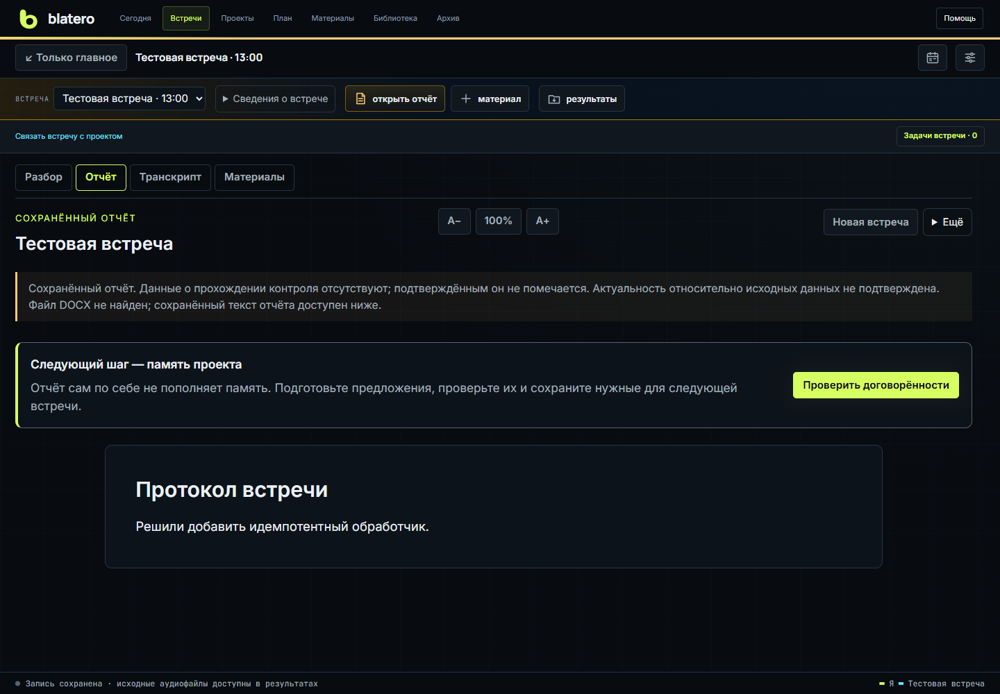
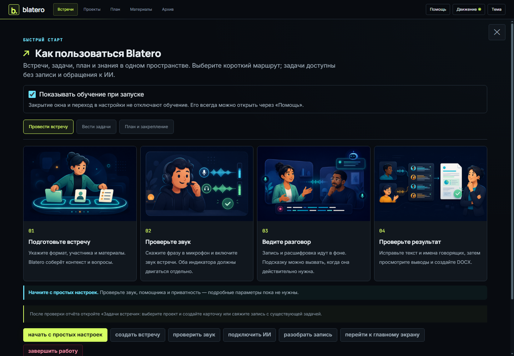
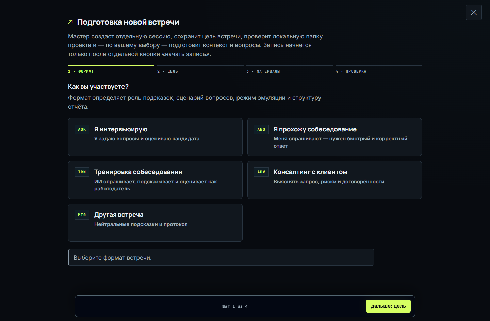
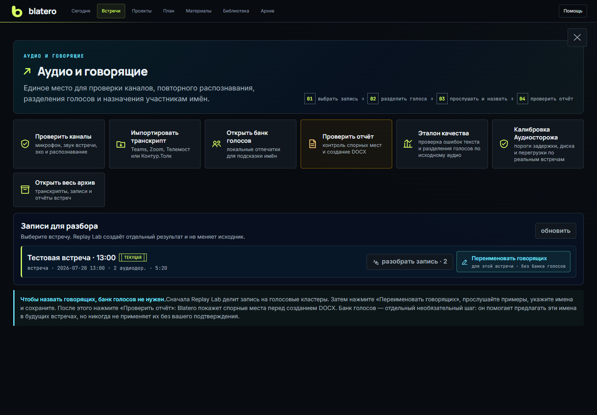
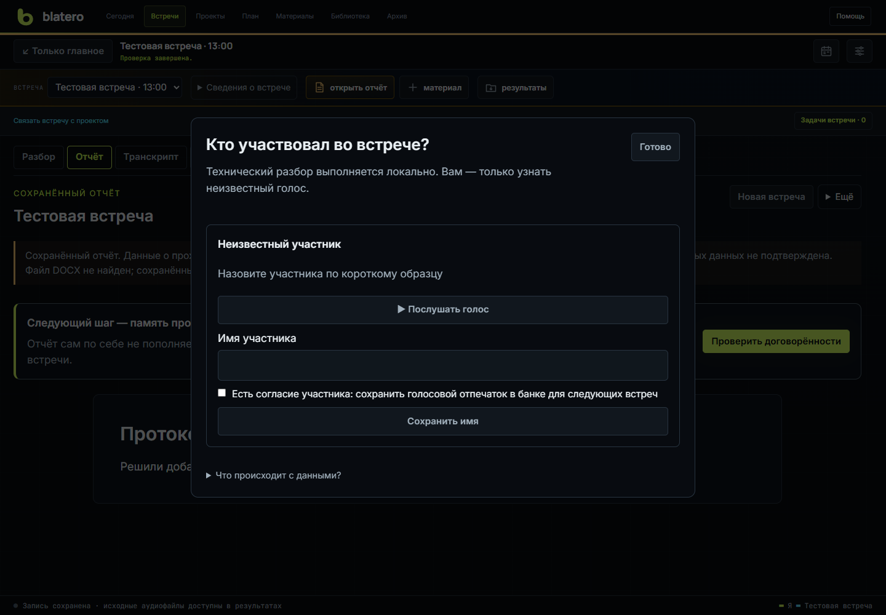
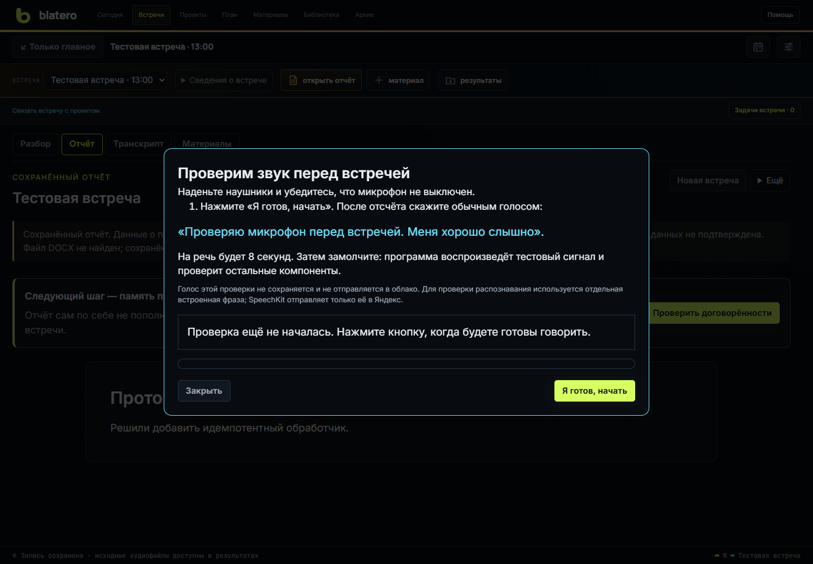

# Blatero: руководство пользователя

[English](en/User-Guide.md)

Практический кейс: [от решения на встрече до задачи](Case-Meeting-to-Task.md).

Blatero объединяет встречи, проекты, план и знания. Встречи дают раздельную
запись звука, транскрипт и проверяемый отчёт; карточки задач сохраняют цель,
метод, причину выбора и следующий шаг. Инструкция сверена с исходниками
1 ноября 2026 года; версия установленной сборки может отличаться.

Для первого знакомства откройте [Единое пространство: быстрый старт](Workspace-Quickstart.md).
Кнопка **«Помощь»** в общей шапке предлагает три маршрута: провести встречу,
вести задачи, планировать и закреплять решения. На доске она работает без
перехода в запись встречи.

В общей [Библиотеке знаний](Knowledge-Library.md) доступны документы, досье задач,
решения и обсуждения. Обновление работает отдельным процессом; предложения,
подтверждение содержания и свежесть оснований разделены. Из материала можно
перейти к задаче и обратно к её досье.

## Быстрый старт

На пустом главном экране этот путь продублирован карточками:
**подготовить -> проверить -> записать -> разобрать**. Обновлённая инструкция
показывается при запуске, пока включена галочка **«Показывать обучение при запуске»**.
Закрытие окна не отключает её. Кнопка **«Открыть настройки»** ведёт к обзору
готовности. Слева находятся разделы и поиск, дополнительные параметры
раскрываются внутри раздела. Общего переключателя «Простые / Подробные» нет.

Чтобы увидеть кнопки на самом экране, выберите **«Помощь → Провести встречу →
Показать на экране»**. Тур предложат один раз при автоматическом открытии
справки, но он начнётся только по нажатию кнопки. Пять шагов покажут, где
настроить звук, создать встречу, проверить готовность, начать запись и открыть
отчёт. Выйти можно кнопкой **«Выйти из тура»** или клавишей Esc. Тур не запускает
запись и ИИ; во время записи он недоступен. Повторный запуск — через «Помощь».

1. Нажмите **«Новая встреча»**: укажите тему либо выберите проект и задачи.
   Для эксперимента задайте тестовый контур в параметрах встречи.

   

2. Укажите участника, компанию или проект, материалы и при необходимости рабочую
   папку. Blatero проверит, достаточно ли в ней данных для подготовки контекста.
3. Нажмите **"Проверить всё"**. Готовность микрофона, системного звука, AEC,
   распознавания и ИИ должна быть подтверждена до начала записи.
4. Начните запись. В рабочем контуре подтвердите уведомление участников или
   иное применимое основание. Кнопка с искрой запрашивает следующий вопрос или
   оперативную подсказку по текущему разговору.
5. После **«Стоп»** нажмите **«Завершить и создать отчёт»**. Неизвестные
   голоса можно проверить через **«Участники и банк голосов»**; подробный
   редактор не является обязательным шагом.
6. Проверьте выводы и создайте DOCX. Затем подтвердите нужные договорённости
   для памяти проекта. Это не принимает задачи трекера автоматически.

Чтобы остановить локальный сервер, выберите **«Инструменты → Завершить работу»**
в шапке или **«Настройки → Обслуживание → Завершить Blatero»**. Стартовая
инструкция только подсказывает, где искать команду. Во время записи выход
заблокирован: сначала остановите запись, чтобы сохранить последние реплики.

## Подробные процессы

Это руководство остаётся короткой картой интерфейса. Пошаговые и справочные
разделы вынесены на отдельные страницы:

| Процесс | Подробная страница |
|---|---|
| Задачи, знания, план, материалы, Гранка и Neon Legion | [Единое пространство](Workspace-Quickstart.md) и [Проекты и задачи](Projects.md) |
| Мастер, типы встреч, рабочая папка и вопросы | [Новая встреча и подготовка](Meetings-and-Preparation.md) |
| Запись, подсказки, сегменты, эмуляция и Аудиосторож | [Живая встреча](Live-Meeting.md) |
| Микрофон, loopback, AEC, Replay, голоса и редактор | [Аудио и говорящие](Audio-and-Speakers.md) |
| Моя тренировка, адаптация и AI x AI | [Тренировочный центр](Training.md) |
| Контроль выводов, DOCX, перенос и удаление | [Отчёты и архив](Reports-and-Archive.md) |
| Календарные подключения и память проекта | [Календарь и память](Calendar-and-Memory.md) |
| Назначение каждого поля настроек | [Справочник настроек](Settings-Reference.md) |
| LLM, распознавание, озвучивание, согласие и промпты | [Провайдеры и приватность](Privacy-and-Providers.md) |
| Portable, модели, обновление и восстановление после сбоя | [Установка и восстановление](Installation-Recovery-Updates.md) |
| Типовые ошибки | [Диагностика неполадок](Troubleshooting.md) |

## Рабочий и тестовый контуры

Контур выбирается в параметрах встречи. В рабочем контуре показываются реальные собеседования и консультации,
в тестовом - пробные записи, настройка и эксперименты. Списки встреч, архив и
новые результаты фильтруются по выбранному контуру; у тестового режима жёлтая
рамка и постоянная метка `TEST`, поэтому его трудно перепутать с боевым.

Существующие встречи без явной метки считаются рабочими. Перенести текущую
встречу можно в настройках, но только когда запись остановлена.

## История транскрипта на главном экране

Главный экран собирает реплики из всех сегментов одной встречи. Счётчик над
историей показывает полное число финальных STT-фрагментов; соседние фрагменты
одного канала визуально объединяются в цельную реплику, но исходный JSONL и
Markdown не изменяются. Ссылка **"транскрипт целиком"** открывает объединённый
текст, даже если запись останавливалась и продолжалась несколько раз.

Для очень длинной встречи сначала загружаются последние 200 фрагментов. Если
ранние части скрыты, интерфейс прямо показывает это и предлагает загрузить всю
историю. Ограничение не маскируется под полный транскрипт.

## Аудио и говорящие

Эта панель собирает в одном месте все операции с записью и участниками.

- **Проверить каналы** - микрофон, системный выход приложения встречи,
  эхо, распознавание и подключение ИИ.
- **Разобрать запись** - открыть Replay Lab для выбранной архивной встречи.
  Повторный прогон не меняет исходные WAV и транскрипт.
- **Переименовать говорящих** - прослушать реплики каждого кластера, объединить
  ошибочно разделённые голоса и подписать участников.
- **Проверить отчёт** - открыть контроль спорных мест и создать DOCX после
  проверки говорящих.
- **Банк голосов** - сохранить локальные числовые отпечатки знакомых голосов.
  Предложенное имя всегда требует ручного подтверждения.
- **Импортировать транскрипт** - добавить выгрузку приложения встречи в одном
  из поддерживаемых текстовых или документных форматов.
- **Эталон качества** - сравнить STT, AEC и диаризацию с подтверждённой ручной
  разметкой.
- **Калибровка Аудиосторожа** - подобрать пороги только после накопления
  достаточного числа подтверждённых встреч.

### Как разделить говорящих и назначить имена

1. В панели **"Аудио и говорящие"** найдите нужную встречу и нажмите
   **"разобрать запись"**.
2. Выберите дорожку. Обычно системный звук содержит удалённых участников, а
   микрофон - ваш голос и возможное эхо из наушников.
3. Оставьте включённым **"Разделить голосовые кластеры"**, задайте примерное
   число голосов и запустите эксперимент.
4. После завершения вернитесь в панель и откройте
   **"Переименовать говорящих"**.
5. Прослушайте характерные фрагменты, объедините одинаковые голоса и назначьте
   имена. Не подписывайте голос только по одной короткой или шумной реплике.

Если кнопки **"Переименовать говорящих"** ещё нет, для встречи не создан
результат диаризации. Сначала выполните Replay с включённым разделением голосов.

## Проверка звука до встречи

- В поле **«Микрофон»** выберите реальное устройство, а не случайный виртуальный
  вход. Нажмите «Проверить микрофон», дождитесь отсчёта и говорите 12 секунд.
  Прослушайте «Вашу пробу»: наличие сигнала само по себе не доказывает речь.
- В поле **"Системный звук встречи"** выберите тот же выход, который использует
  приложение встречи или браузер, и включите тестовый звук.
- Если микрофон слышит наушники, выполните AEC-калибровку в тихой комнате и не
  меняйте громкость или устройства после неё.
- При смене гарнитуры Blatero помечает калибровку устаревшей. Повторите её перед
  записью.
- Кнопка **"скачать диагностику"** создаёт локальный пакет состояния без
  отправки записи в облако.

## Где искать основные функции

| Задача | Где находится |
|---|---|
| Создать рабочую задачу без встречи | «Проекты» в общей шапке |
| Связать разговор с карточкой | «Задачи встречи» под текущей встречей |
| Посмотреть общую неделю задач и публикаций | «План» в общей шапке |
| Связать встречу или статью Гранки с задачей | «Материалы» в общей шапке |
| Вспомнить цель, метод и причину | «Вспомнить» в проекте или в карточке |
| Повторно открыть обучение | «Помощь» в общей шапке |
| Создать интервью, консультацию или тренировку | верхняя кнопка "Новая встреча" |
| Проверить готовность | верхняя кнопка "Проверить всё" |
| Посмотреть расписание | верхняя кнопка календаря |
| Разобрать аудио и говорящих | Настройки → Обслуживание → Аудио и говорящие |
| Открыть старые результаты | Архив в общей шапке |
| Настроить LLM, звук и приватность | Настройки → нужный раздел |
| Изменить системные промпты | Настройки → ИИ и подсказки → Дополнительно |
| Установить Whisper, Chatterbox и модели голосов | Настройки → Обслуживание → Локальные модели |
| Открыть папку текущего отчёта | кнопка "открыть папку" в группе "Результаты" |
| Найти действие без меню | `Ctrl+K` |

## Отчёт

Перед DOCX Blatero показывает экран контроля качества. Сверьте сомнительные
реплики и голоса; внутренние обсуждения после интервью не должны попадать в
финальный документ. Таймкоды в отчёте по умолчанию выключены и включаются только
явно в настройках. Имя файла формируется из имени участника и даты встречи.

## Приватность

Запись, Replay Lab, AEC, локальное распознавание, диаризация и банк голосов
работают локально. LLM получает очищенный текст; SpeechKit при выборе облачного
распознавания получает аудио, облачный TTS — текст для озвучки. Выбранные картинки
отправляются только после отдельной проверки и подтверждения. Пароли и
API-ключи хранятся в системном защищённом хранилище; секреты не должны
записываться в документы или репозиторий.
