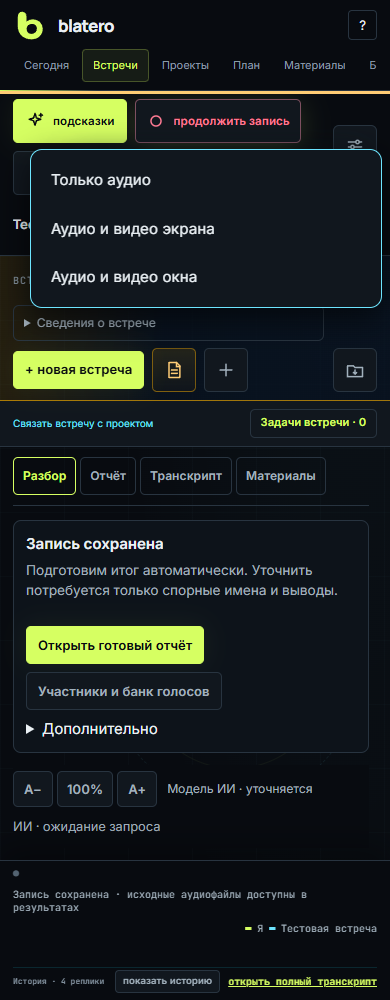
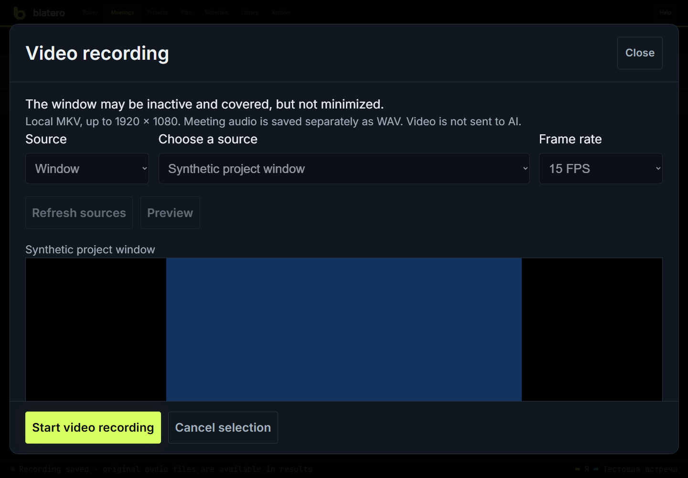

# Видеозапись экрана или окна

Видеозапись доступна в исходниках начиная с 1.0.0-rc.41 на Windows.
Версию установленной программы проверяйте отдельно: обновление исходников
не означает перезапуск сервера или выпуск нового portable.

## Аудио вместе с видео

Начиная с 1.0.0-rc.42 кнопка **«Запись»** открывает три варианта:



- **«Только аудио»** — обычная запись встречи без видео.
- **«Аудио и видео экрана»** — после выбора укажите нужный экран.
- **«Аудио и видео окна»** — после выбора укажите конкретное окно.

Для двух вариантов с видео нажмите **«Предпросмотр»**, проверьте изображение
и выберите **«Далее: начать запись»**. В следующем окне подтвердите запись встречи.
До подтверждения идёт только предпросмотр, запись встречи ещё не началась.
Отмена закрывает подготовленный предпросмотр. Он также истекает через 90 секунд.

Кнопка **«Стоп»** останавливает аудио и видео, запущенные этим общим действием.
Если видео не запустится, аудио продолжит записываться; сообщение об этом
останется в верхней части интерфейса. Если при запуске откажет аудиопроцесс,
связанное видео остановится. Самостоятельная запись видео из материалов не
подключается к этой паре автоматически.

## Только видео или дополнительное видео во время встречи

1. Откройте встречу и нажмите **«＋ материал» → «Видео»**.
2. Выберите **«Окно»** или **«Экран»**, затем нужный источник в списке.
   Само открытие панели не включает захват.
3. Нажмите **«Предпросмотр»**. Убедитесь, что на изображении нужный источник.
4. Нажмите **«Начать видеозапись»**. В верхней панели появится кнопка
   остановки видео с таймером. Она остаётся доступной в режиме «Только главное».

Можно выбрать 15 или 30 кадров в секунду. Размер ограничен 1920 × 1080;
соотношение сторон сохраняется. При изменении размера окна добавляются поля
внутри прежнего размера видео, без растяжения изображения.

Для окна не требуется фокус: можно перейти в другое приложение и перекрыть
выбранное окно. **Не сворачивайте его.** Свёрнутое или закрытое окно становится
недоступным, и видеозапись прерывается. Другой источник автоматически не включается.

## Звук и остановка



**Видеофайл MKV не содержит звука.** Аудиоканалы встречи сохраняются отдельно
в WAV обычной записью Blatero. Для общего запуска используйте меню **«Запись»**.
При самостоятельном запуске через материалы включите запись встречи отдельно.
Начало или остановка отдельного видео не включает и не выключает микрофон,
распознавание или запись WAV. Сведение видео со звуком в один файл не входит
в эту версию.

Закрытие панели видео или вкладки браузера не останавливает видеозапись:
ею владеет локальный сервер. Для остановки нажмите **«Остановить видео»**
или верхнюю кнопку **«■ Видео · время»**. Дождитесь сообщения **«Видео сохранено»**.

Перед завершением сервера, сменой встречи или очисткой её данных нужно
остановить видео. Предпросмотр без запуска истекает через 90 секунд.
Максимальная продолжительность одного видео — четыре часа. Нехватка места
или достижение лимита прерывают видео, а не аудиозапись встречи.

## Найти и удалить файл

После остановки файл доступен в **«＋ материал» → «Видео встречи»** и в истории
панели видео по ссылке **«Скачать MKV»**. Используйте проигрыватель с поддержкой
Matroska/H.264. Встроенное воспроизведение MKV в каждом браузере не гарантируется.

В каталоге встречи создаётся отдельная папка:

```text
video/<идентификатор>/
  recording.mkv          завершённый и проверенный файл
  preview.png            предпросмотр выбранного источника
  state.json             состояние и контрольная сумма
  worker.log             журнал видеопроцесса
```

При аварии вместо завершённого файла остаётся `recording.partial.mkv`.
Blatero не объявляет такую запись завершённой; в истории доступна
**«Скачать сохранённую часть»**. Читаемость последних кадров зависит от момента
сбоя. Уже сохранённый материал автоматически не удаляется и не перезаписывается.

Удаление: **«Настройки» → «Обслуживание» → «Данные встречи»**. Выберите
**«видео и предпросмотры»**, рассчитайте удаление, проверьте перечень и подтвердите.
Эта категория отделена от аудио. Автоматическое удаление видео по сроку
по умолчанию выключено. Зашифрованный перенос встречи включает папку видео;
действуют общие ограничения размера переносимого пакета.

## Приватность и ограничения

- Файлы остаются локальными. Видео не отправляется в ИИ и не анализируется
  автоматически вместе с документами встречи.
- При выборе экрана записывается всё, что на нём видно. При выборе окна
  персональные данные внутри самого окна тоже попадут в файл. Маскирования
  областей во время видеозаписи пока нет.
- Если выбрано окно браузера, переключение вкладки в этом окне меняет
  записываемое изображение. Для параллельной работы используйте другое окно,
  а не другую вкладку того же окна.
- Видеозапись доступна только с локального компьютера, не из удалённой панели.
- Захват использует Windows Graphics Capture. Защищённое содержимое может
  быть недоступно; защита не обходится. Некоторые приложения замедляют
  обновление изображения в фоне.
- Отдельные диалоги и всплывающие окна приложения не считаются автоматически
  частью выбранного окна. Проверяйте предпросмотр; для всего экрана выбирайте
  именно экран, учитывая риск записи посторонних данных.
- Блокировка сеанса, отключение монитора, отказ драйвера и сворачивание не
  гарантируют продолжение видео. Запись WAV от видеопроцесса не зависит.

## Если компонент видео отсутствует

В Windows portable зависимости видео включаются при сборке. Для запуска
из исходников установите `requirements-video.txt` **в то же окружение Python,
из которого работает Blatero**, и перезапустите сервер после остановки записей.
Не устанавливайте пакеты в случайный системный Python.

```text
.venv\Scripts\python.exe -m pip install -r requirements-video.txt
```

Если установка не удалась, обычные встречи, WAV, распознавание и отчёты
продолжают работать без видео. Не требуется менять SpeechKit, голоса или ключи.
