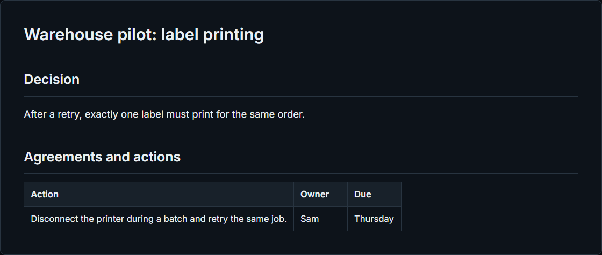
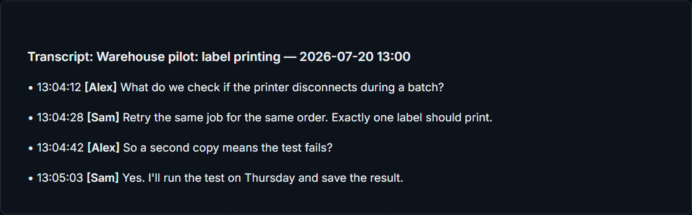
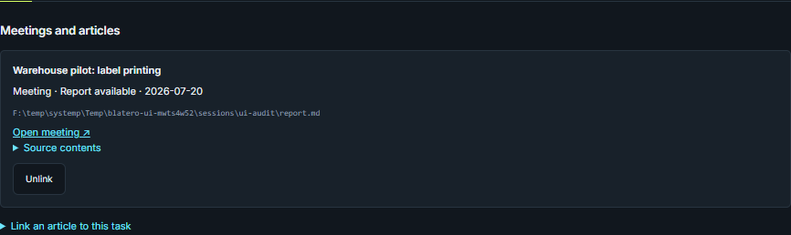

# Worked example: from a meeting decision to a task

[Русский](../Case-Meeting-to-Task.md) · [Blatero help](Home.md)

**Scenario.** A printer disconnected during a warehouse pilot. In the follow-up,
the team agreed on an acceptance criterion: retrying the job for the same order
must produce exactly one label. Your job is to verify what was said and leave a
link to the original discussion on the existing task.

**Before you start.** You need a completed meeting with a saved report and
transcript, and an open project task. The screenshots use a fictional meeting,
“Warehouse pilot: label printing”, and the task “Test a printer retry without
duplicate labels”. You can substitute your own meeting and task. These steps
do not start a recording, regenerate a report or require an AI connection.

## 1. Find the decision and action in the report

In **Meetings**, open the completed meeting and select **Report**. Separate
the **criterion** — one label for the same order after a retry — from the
**action** — disconnect the printer during a batch and retry the job.
In the sample, Sam owns that action and plans to run it on Thursday.

## 2. Check the wording against the transcript

Open **Transcript** and find “Retry the same job for the same order” and
“Exactly one label should print”. The next turn clarifies that a second copy
means the test fails. That is the acceptance criterion, not a claim that the
test has passed. If the speaker or wording is unclear, check the corresponding
passage in [Audio and speakers](Audio-and-Speakers.md).

## 3. Link the meeting to the task

Choose **Meeting tasks**, select the project, then select **Test a printer
retry without duplicate labels** from the existing tasks. Use the button below
the list to link it. In 1.0.2-rc.8, that button still reads
**«Связать с выбранной задачей»** (“Link to the selected task”).
Open the linked card. Under **Meetings and
articles**, the source shows the meeting title and a link back to it. Follow
the link to return to the report or transcript.

**Expected result.** The task links back to the meeting and the meeting links
to the task. The task status, report and transcript are unchanged. If the task
needs a next step, enter it in the card separately. If there is no task yet,
the same dialog can create one. Project memory is separate: it keeps only
items you confirm in [report review](Reports-and-Archive.md).
