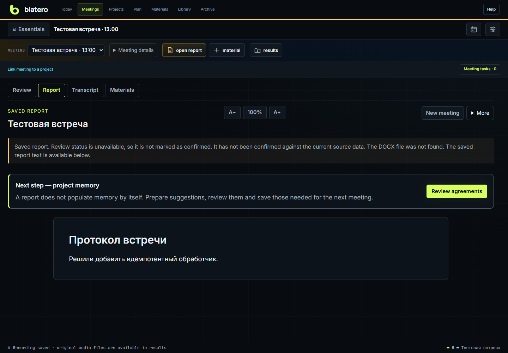

# Blatero help

Reviewed against the application on 1 November 2026. Check the running server's
version separately: replacing files does not restart an older process.

[Русская справка](../Home.md)

Blatero is a local workspace for meetings, tasks and knowledge. Meetings keep
separate microphone and system-audio tracks, a transcript, hints and a reviewed
report. Tasks retain the goal, method, rationale, evidence and next step.

## First meeting

1. Open **Settings**. Select your microphone, the meeting application's output
   and speech recognizer. Configure an AI connection if you want hints/reports.
2. Choose **New meeting**. Enter a topic, or select a project, tasks and time
   and load local materials and previous agreements. Creation does not record.
3. Run **Check all**, click the readiness button, wait for the countdown and
   speak the displayed phrase. Then stay quiet for the system-audio test.
4. Choose **Record**: audio only, audio with a screen, or audio with a window.
   Video requires a selected source and preview. For work recordings, confirm
   participant notification or another applicable basis.
5. After **Stop**, choose **Finish and create report**. Review unknown speakers
   or doubtful passages when needed; detailed phrase editing is optional.
6. Review conclusions, create DOCX, then open **Review agreements**. Only items
   you select and confirm become memory for the next meeting.

For experiments, use the test data environment in meeting settings. Switching
recognizers does not stop the WAV capture. Offline help needs no Internet.

Worked example: [verify a decision and link the meeting to a task](Case-Meeting-to-Task.md).

## Contents

| Task | Guide |
|---|---|
| Install, launch or update | [Installation and recovery](Installation-Recovery-Updates.md) |
| Find your way around | [Quickstart](Workspace-Quickstart.md), [User guide](User-Guide.md) |
| Follow a complete workflow | [End-to-end processes](End-to-End-Processes.md) |
| Prepare a conversation | [Meetings and materials](Meetings-and-Preparation.md) |
| Record, read hints and stop | [Live meeting](Live-Meeting.md) |
| Record an inactive window or screen | [Video recording](Video-Recording.md) |
| Add files or a screenshot during a meeting | [Live materials](Live-Materials.md) |
| Check audio, replay or identify speakers | [Audio and speakers](Audio-and-Speakers.md) |
| Interview practice or explain a project | [Training studio](Training.md) |
| Review conclusions, export or delete | [Reports and archive](Reports-and-Archive.md) |
| Reuse confirmed agreements | [Calendar and memory](Calendar-and-Memory.md) |
| Track work and agent results | [Projects](Projects.md), [Today](Daily-Workspace.md) |
| Search documents and decisions | [Knowledge library](Knowledge-Library.md) |
| Understand each setting | [Settings reference](Settings-Reference.md) |
| Set up credentials | [Provider setup](Provider-Setup.md) |
| Understand data flow | [Privacy and providers](Privacy-and-Providers.md) |
| Connect other applications or change language | [Integrations and languages](Integrations-and-Languages.md) |
| Before sharing a pilot | [Recording policy](Recording-and-Policy.md), [Pilot testing](Pilot-Testing.md) |
| Diagnose an issue | [Troubleshooting](Troubleshooting.md), [Glossary](Glossary.md) |

English is the interface/help language, not a switch for meeting content.
Current live STT profiles are configured for Russian. User documents, names,
reports and model responses are not automatically translated.
