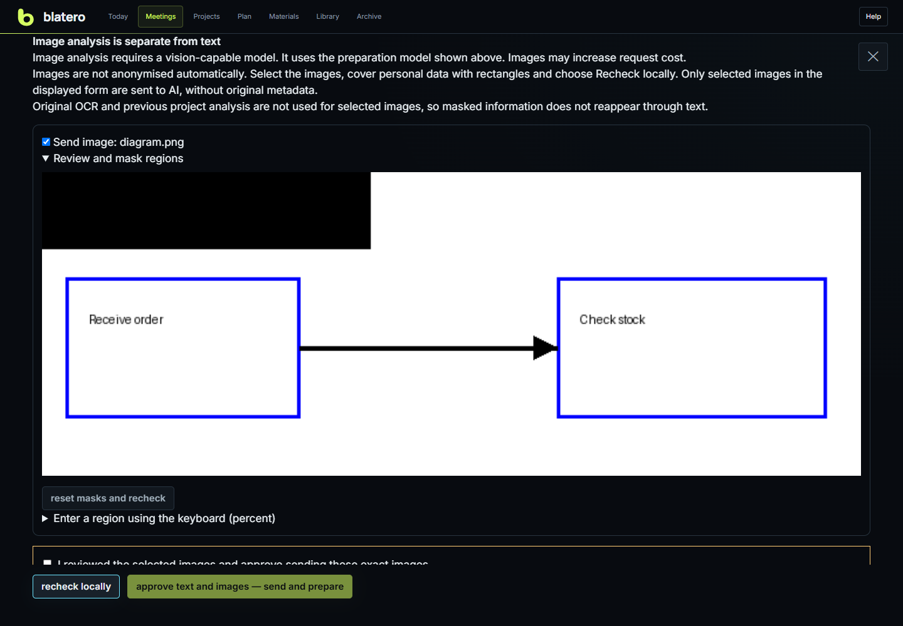

# Create and prepare a meeting

Creation makes a separate session before microphones or AI are started. **New
meeting** is the short route: topic, project/tasks and time. Choose **Detailed
wizard** for role, objective, materials and readiness. Use work data for a real
decision about a person/client/project; use test data for experiments. The choice
is in meeting parameters, not an extra permanent toolbar row.

## Choose the format

| Format | You are | Hints and report |
|---|---|---|
| I interview | Interviewer | Open follow-up questions; evidence, strengths, risks and untested areas |
| I am interviewed | Candidate | A short answer scaffold; answer review and practice plan |
| Training | Learner | Graded practice, support and competence history |
| Consulting | Consultant | Needs, clarifications, risks, decisions and follow-up |
| Other meeting | Participant | Neutral next steps, decisions, actions and open questions |

Format cannot change during REC. Display names do not reverse physical channels.
Duration guides hints; it is not automatic stop time. Topic/participant contributes
to the report filename. Client/project connects memory, so check spelling before
creating another profile for the same work.

## Four wizard steps

1. **Format:** select your role.
2. **Goal:** enter topic/name, duration, client/project, purpose, requirements or
   required questions. Do not paste passwords or API keys.
3. **Materials:** choose a local folder, check the path, and optionally request
   preparation after creation. A path check is local, not an AI request.
4. **Review:** inspect role, data environment, goal and material status, then
   create. Recording still needs a separate action and readiness check.

For project/task meetings, **Load context** reads selected cards, the project's
folder, likely registries, confirmed memory and up to five earlier work reports.
Choose the documents yourself when several registries exist. Up to 20 tasks and
16 selected documents are used; browsing is bounded to 2,000 files/800 folders/
500 entries per branch. Archived/service/test/prompt trees are excluded. Registry
rows matching task numbers have priority; missing materials are a warning, not
invented context. Reports are evidence, not automatically confirmed memory.

**Create and open** saves agenda, compact dossier and source snapshots; extended
details are in `preparation-details.md`. It does not change task status, generate
AI content or send external invitations. If tasks/documents change after preview,
load again. Retrying an uncertain creation continues the same request rather
than creating a second meeting. Closed tasks can be inspected but not newly linked.

## Supported workspace files

| Format | Extracted content / requirement |
|---|---|
| TXT, Markdown, CSV, TSV, source code | Text, including UTF-16 with a BOM |
| DOCX, ODT | Paragraphs and tables; Word not required |
| PDF | Text layer, at most 100 pages; scanned pages need separate images |
| XLSX | Cell text/values, formula and cached result; no recalculation |
| PPTX | Slide text, not design or embedded picture interpretation |
| DOC, XLS, PPT, RTF | Local LibreOffice conversion, then text extraction |
| Draw.io | Pages, nodes, labels and links, including compressed diagrams |
| BPMN/BPMN2 | Process elements, flows, conditions and lanes |
| VSDX, VDX | Shapes/labels and available connections; incomplete stencils possible |
| VSD | LibreOffice to FODG; some original properties may be lost |
| SVG | Text/geometry, explicit relations, embedded Draw.io where present |
| ODG, FODG | Pages, labels and available relations |
| PNG, JPEG, BMP, TIFF | Local OCR; separately opted-in visual AI analysis |

The source is not modified. Legacy conversion uses temporary copies, an isolated
LibreOffice profile and disabled macros/active content; this is not a complete
OS sandbox. Unsafe external links are rejected, sometimes conservatively.
Read **Material inventory** for accepted/partial/skipped files and remediation.

Documents/images are limited to 10 MiB per file and Office containers to 20 MiB
unpacked. Up to 12,000 characters per selected file/120,000 per folder are used.
Word lock files (`~$`) are skipped. Archives are not automatically unpacked;
binary `.epf` is not source code. Embedded images and multipage TIFF need separate
image files; audio/video are not transcribed by workspace scanning.

Windows OCR needs an installed language component. Russian is preferred when
available, otherwise the Windows profile language. Missing OCR is reported;
other files continue. OCR reads labels, not diagram meaning. Up to eight images,
15 seconds each, with no new OCR launched after 45 total seconds; the last job
may finish later. Images over 20 megapixels need reducing/splitting. Legacy
conversion also uses at most eight files, 45 seconds each, and no new job after
90 seconds. Large batches should be split into smaller folders.

## Review what is sent

For workspace preparation, **What will be sent to the cloud** appears before
generation. Check recipient/model, file selection, exact outgoing text and
system instruction. Add one custom hidden term per line and **Recheck locally**
after changing anything. Close cancels; it does not send. Excluded files also
invalidate prior summaries that could contain their information.

Detection uses local Russian-name analysis plus contact/document/secret rules.
It can miss foreign names, inflections, OCR errors and indirect identifiers.
Consistency is within a request, not global pseudonymous identity. This reduces
risk; it is not guaranteed anonymization. Other hint/report/training requests
use the common redaction boundary without this full per-request review screen.

## Visual diagrams and images

1. Choose a preparation model/route that accepts images. Codex needs a logged-in
   CLI supporting image attachments; OpenRouter/OpenAI/Anthropic/compatible routes
   depend on the actual model. Direct DeepSeek visual input is unavailable here.
2. Select images explicitly. Mask sensitive rectangles by mouse or percentage
   coordinates, reset if necessary, then recheck.
3. Inspect the prepared pixels and give separate image permission, then confirm.

Prepared PNGs have no source metadata, at most 1,600 px on the long side, up to
eight images/40 masks each. Masks are burned into pixels, not a display overlay.
Selected images' original OCR and the old project summary are omitted. Small
labels may become unreadable: split a large diagram. This handles image files,
not embedded Word/PowerPoint pictures or PDF pages. Images can increase cost.

Permission is single-use, expires in 15 minutes and binds the exact inputs,
recipient/model/context. Changes, cancellation, session switch or server restart
invalidate it. Detector failure blocks sending. Cloud permission remains a
separate requirement. If AI is unavailable, keep the wizard draft and create
the meeting without AI preparation; local capture need not depend on a dossier.

