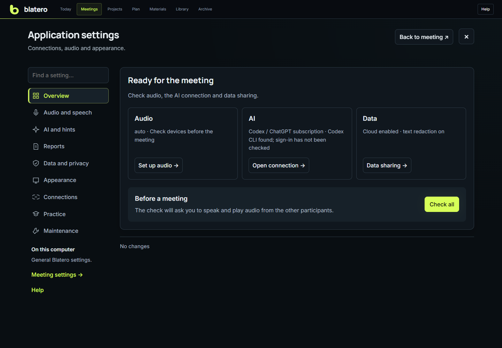
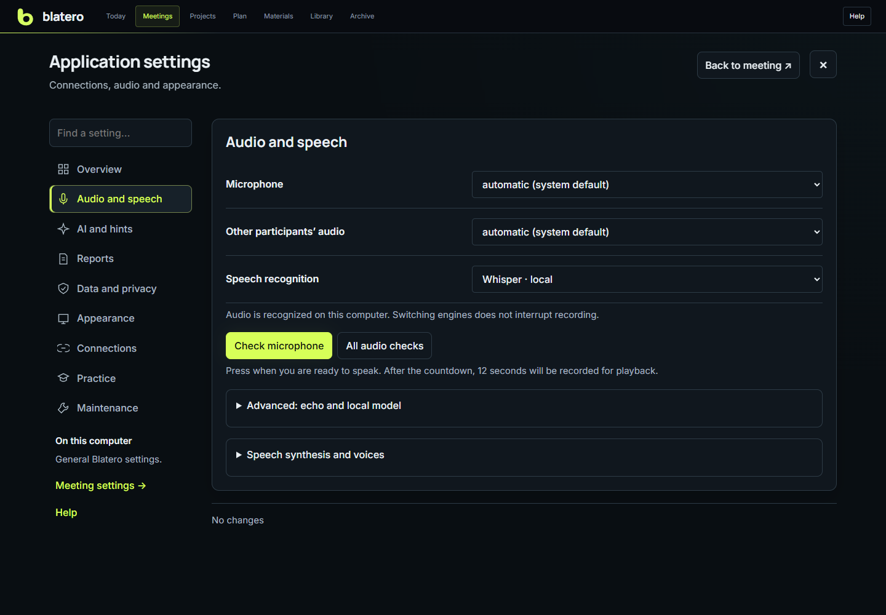

# Settings reference

Open **Settings** from the meeting toolbar. The overview shows readiness;
sections and search are on the left, or in a list on narrow screens. Advanced
fields expand within their section. There is no global Simple/Advanced switch.
Use **Back to meeting** at the top to return. Meeting parameters are separate
from application settings and are linked beneath the section menu.

## Automatic call recording

**Integrations** has separate Telemost and Kontur.Talk switches and automatic
recording permission. Saving starts the background helper for this Windows session
and registers it for subsequent sign-ins. Its status and last error appear below
the controls. Turning off both apps or the permission stops the helper.

Windows microphone use by the selected native app triggers recording. Sound checks
before joining can trigger it too. Joining muted can delay the start. Audio sources
and transcription use the settings in **Audio and speech**. Finish with **Stop**
in Blatero.

In-app mute keeps an ongoing Blatero recording running. Blatero captures the
selected microphone independently and includes your voice while the meeting app
is muted. If the app opens the device when you unmute, the automatic start signal
appears at that point.

## Saving and scope

Application and meeting fields are drafts until **Save changes** succeeds.
**Discard changes** restores the current section. Moving between sections keeps
drafts. A conflict, server error or lost connection does not silently discard
them. On close you can save, discard or continue editing. A draft is not a backup
on disk; save before closing the browser.

Theme, motion and panel layout apply immediately in this browser. General font
size has a preview and a save action. Connection save/test has its own action.
Testing audio, calibration, preparing context and installing/removing components
are separate operations: save relevant fields before running them.

## Overview and startup guide

The overview shows selected audio, AI access and data sharing. Configured access
does not mean a successful connection test. **Check all** opens instructions;
it does not start unexpectedly before you click that you are ready.

**Help** offers meetings, tasks, and planning/recall. **Show guide on startup**
is enabled by default for the meeting page. Closing the guide or entering settings
does not clear it. It appears on a fresh page load, not every internal navigation,
and not automatically during a recording. The choice is per browser. Help on
the board is opened manually. A storage failure is shown rather than reported
as a saved preference.

## Meeting parameters

| Field | Effect | Scope and limits |
|---|---|---|
| Work/test data environment | Separates work meetings from experiments | Set when idle; filters archive, memory and metrics |
| Format and role | Changes hints, participant roles and report structure | Interviewer, candidate, training, consulting, other; not changeable during REC |
| Topic/participant | Session label and report filename | Correct before creating the final document |
| Duration | Time guidance for hints | Does not stop recording; no limit disables time guidance |
| Client/company | Shared client-memory key | A consistent name connects related meetings |
| Project name | Explicit project-memory key | Workspace folder name is used when blank |
| Workspace | Local project materials and code | The absolute path is not sent to the model |
| Bot role | Other participant in SIM | Defaults from the meeting format |
| Microphone/system channel names | Display aliases | Canonical channel identities remain unchanged |

**New meeting** creates without starting REC. **Import transcript** adds a
separate segment. **Choose folder** and **Check path** inspect locally, without
an AI call. **Prepare context** takes a local snapshot, excludes unsupported and
sensitive files, then opens a sending review. Save the workspace before preparing.
Changed/excluded sources invalidate the previous review; empty input is not sent.

## Audio and speech

| Setting | Choices and effect | Default |
|---|---|---|
| Microphone | Actual input for your channel; refresh after reconnecting | System device |
| Meeting audio | WASAPI loopback of the output used by the meeting app | System output |
| Recognizer | Local Whisper or cloud Yandex SpeechKit | Local Whisper |
| Whisper model | Base, small, medium; speed/RAM trade-off | Small |
| Acoustic echo removal | Cleans microphone PCM before STT, not the original WAV | On |
| Echo backend | Auto, WebRTC AEC3, built-in correlation | Auto |
| Cross-channel text deduplication | Suppresses confident copies across channels | On |
| Question speech | Local voice, local with Yandex fallback, Yandex only | Local with Yandex fallback |
| Simulation/fallback voice | Explicit voice or automatic choice | Auto/Filipp |

Additional audio options contain the local model and calibration. **Speech and
voices** contains voice testing, the voice bank and synthesis controls. Cloning
a voice is not required to test the microphone.

**Test microphone**: save the device, click, wait for 3–2–1 and **Speak now**, then
speak for 12 seconds. Read the level/time and play **Your sample**. Repeat starts
a new sample; delete or close frees the sample from browser memory. It does not
create meeting files, a voiceprint or a cloud/STT request. It is disabled during
REC. Speakers can be used instead of headphones, but echo is more likely.

**Check all** additionally exercises both capture routes and real recognition
of a built-in synthetic phrase. See [Audio and speakers](Audio-and-Speakers.md).

Use the dedicated **Switch engine** or **Apply model** action during recording.
The new recognizer prepares beside the old one; the WAV capture is not reopened.
Failure keeps the old recognizer running. Installing an absent model is an idle
operation. Physically changing an audio device is different and may cause a gap.

## AI and hints

| Setting | Meaning |
|---|---|
| Automatic hints | Off, meaningful pauses, or 30/60/90-second intervals |
| Provider | OpenRouter, Codex/ChatGPT, direct OpenAI/Anthropic/DeepSeek, compatible API |
| Hint model | Short live responses; choose latency appropriate to the meeting |
| Report/analysis model | Preparation, reports, Replay analysis and training |
| API token | Saved through Windows Credential Manager; not returned to the browser |
| Base URL | Compatible endpoint; loopback HTTP is local, external HTTPS is cloud |
| Question style | Classic, engineering cases, mix; affects the next generation |
| System prompts | Local overrides with required placeholders; reset individually |
| Scene hint route | Main connection or separate OpenRouter Flash in the studio |

**Save connection**, **Test connection** and **Delete token** are explicit actions.
Testing uses technical metadata, not meeting documents, and successful testing
saves the connection. Failed testing retains the entered token for correction.
Deleting a stored token does not delete credentials configured through another
supported source. Changing provider does not enable cross-provider fallback.

Codex uses the CLI's own login, not this token field. Its actual last model is
shown next to hints when available; an automatic route is not a promise of one
fixed model. Model instructions cannot disable privacy/role guards or grant
agent tools. See [Provider setup](Provider-Setup.md).

## Reports

| Option | Effect | Default |
|---|---|---|
| Show draft before DOCX | Local review/edit before finalization | On |
| Include timestamps and links | Adds local evidence links for audit | Off |

Changes affect newly generated reports, not documents already saved. Confirming
a draft builds DOCX without another AI call. Rebuilding after source changes is
a new generation and is presented separately.

## Data and privacy

**Redact text** is the default. **Raw text** requires additional confirmation.
Revoking cloud permission restores redaction and clears raw permission.
**Consent obtained / cloud enabled** records the operator's decision on this
computer; it is not detected from the conversation and is not per-meeting legal
consent. Cloud LLM, SpeechKit and cloud TTS require it. Local recording and local
models can work without it.

Workspace analysis adds an exact sending preview, file selection, custom hidden
terms and separate image review/masking. This preview is not yet repeated for
every live hint/report/training request. Redaction is risk reduction, not proof
of anonymity. Image pixels require manual review. [Data flow](Privacy-and-Providers.md).

## Appearance

| Setting | Effect |
|---|---|
| Interface language | RU/EN, per browser, shared across meeting and board |
| Text size | 90%, 100%, 115%, 130%; default 115%; save after preview |
| Working layout | Keep current, normal, focus, analysis |
| Scenario width | 320–900 px; normal default 620 px |
| Scenario/history/large history | Independent visibility/height controls |
| Theme and animation | Browser preference; OS reduced-motion setting wins |

**Only essentials** keeps recording, hints and audio status while hiding auxiliary
rows. Hint **A− / percentage / A+** changes only hint text; percentage resets to
100%. These actions do not alter recordings. `Ctrl+B` toggles scenario, `Ctrl+J`
history, `Ctrl+K` commands. **Integrations** are optional and off by default.

## Practice

**I answer**, **I ask** and **Both AI** create separate test training sessions
and open preparation without starting a microphone or AI request. Continue opens
an existing attempt. SIM below these cards uses the current meeting instead;
it is not another studio composition. Speech practice has its own record,
review, repeat and comparison steps. [Training studio](Training.md).

## Maintenance

Open local models, installation/updates/rollback, audio/speakers, recovery,
meeting data/transfer, result cleanup or commands here. Nested tools return to
settings. Local model operations show requirements and locations; removal is
limited to managed directories and keeps the separate voice sample.

Deletion first computes a file list/size and requires confirmation. Result
cleanup removes generated audio/transcripts/hints/reports, not source materials,
resume, dossier or scenario. It is blocked during recording/background work.
**Shut down server** is explicit; stop audio and video first. Closing a browser
tab is not server shutdown.

## Where settings are stored

- `config.json` in the data directory: ordinary application settings.
- `meta.json` in each meeting: meeting metadata.
- Browser local storage: view, language and draft preferences.
- Windows Credential Manager: LLM tokens and calendar secrets.
- `%USERPROFILE%\.yc-speechkit-key`: legacy plaintext SpeechKit API key; not
  covered by Credential Manager. Protect and revoke it as described in setup.
- Local prompt overrides: the data directory, not shipped defaults.

Do not distribute your configuration, credentials or meeting folder as a test
package. Use the [encrypted transfer](Reports-and-Archive.md) for chosen sessions.
