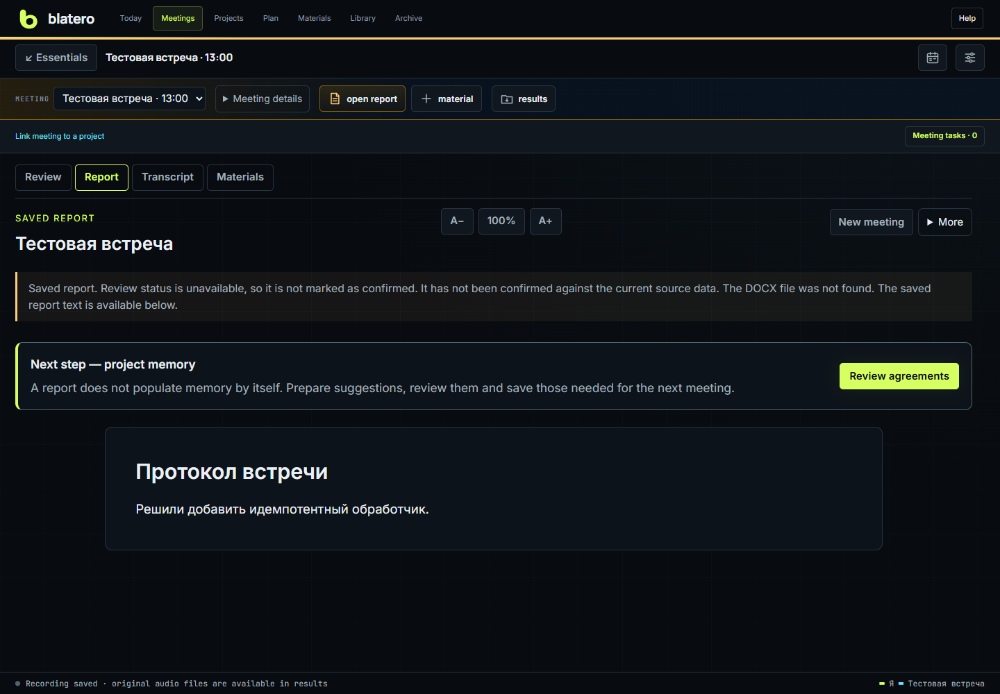

# User guide

Blatero combines meetings, projects, a plan and a knowledge library. You can use
task tracking without a microphone or model. **Help** in the shared header offers
three routes: hold a meeting, track tasks, plan and recall.

## Quick start

Extract the whole portable ZIP, start `Blatero.exe`, open **Settings** and choose
audio plus optional AI access. The overview links to the relevant section; more
technical options expand within it. Save fields before running a test.

The illustrated guide opens on the meeting screen while **Show training on
startup** is enabled. Closing it does not change that preference; use **Help**
to reopen it.

Choose **Help → Run a meeting → Show me around** to highlight the controls on
the meeting screen. The guide offers the tour once when it opens automatically,
but the tour never starts by itself. It covers settings, meeting creation,
readiness checks, recording and hints, and reports. Choose **Exit tour** or
press Esc to leave. The tour does not start recording or make AI requests
and is unavailable while recording. Reopen it from **Help** whenever needed.

Create a meeting by topic or project/tasks/time. Creation is local and silent.
Run **Check all** when ready to speak. Choose audio or audio+video, confirm the
recording basis, then use hints while talking. Stop, review conclusions, export
DOCX and confirm useful agreements for next time. Detailed speaker editing is
not mandatory. [Full route](End-to-End-Processes.md).

## Work and test data

Meeting parameters choose work/test. Use test for device setup, experiments and
synthetic training; work for real discussions. Archive, new results, memory and
metrics respect the environment. Existing unlabelled legacy meetings are work.
Move a session only while idle. Test flags do not make personal material safe
to publish or permit cloud processing.

## Find an action

| Need | Location |
|---|---|
| Current focus, questions and pending review | Today |
| Create or edit a work card | Projects |
| Project/task meeting | New meeting → project and task selection |
| Weekly meetings/task deadlines | Plan |
| Link meeting, agreement or article | Materials / Meeting tasks |
| Find documents/decisions | Library |
| Inspect older meetings | Archive |
| Read transcript | Transcript tab / full history link |
| Set microphones, recognizer, AI, privacy | Settings → relevant section |
| Speaker review, Replay, references | Settings → Maintenance → Audio and speakers |
| Install/remove optional models | Settings → Maintenance → Local models |
| Practice speech or interviews | Settings → Practice |
| Local data export/deletion/recovery | Settings → Maintenance |
| Find commands | `Ctrl+K` |

**Only essentials** removes auxiliary rows without changing files; hint font
controls affect hints only. Scenario/history visibility is separate from history
height. The transcript can initially show only the last 200 final fragments;
the counter and full-history action make this visible rather than truncate data.

## What is saved

Each physical audio source has its WAV; final events are in JSONL with readable
Markdown. Continue creates another segment. Switching installed recognizers does
not stop RAW capture. Replay and AI/studio results use separate derivatives.
The report filename contains topic/participant and date; timestamps are off by
default. Open/download/print a saved report without paying to generate it again.

## Privacy and closing

Local Whisper, AEC, speaker separation and editor stay local. Cloud STT receives
audio; cloud TTS receives text; a cloud LLM receives text and separately approved
images where supported. Redaction is not a guarantee of anonymity. Read
[Privacy](Privacy-and-Providers.md) and [Recording policy](Recording-and-Policy.md).

Closing a tab does not stop the server. Stop recordings first, then choose
the shutdown action from **Tools** or **Settings → Maintenance**.
The startup guide points to the command but does not stop the server itself. Do not force-kill all Python
processes. Do not distribute personal keys/configuration/meetings with portable.

For every option see [Settings](Settings-Reference.md); for failures see
[Troubleshooting](Troubleshooting.md), or open [all help](Home.md).
