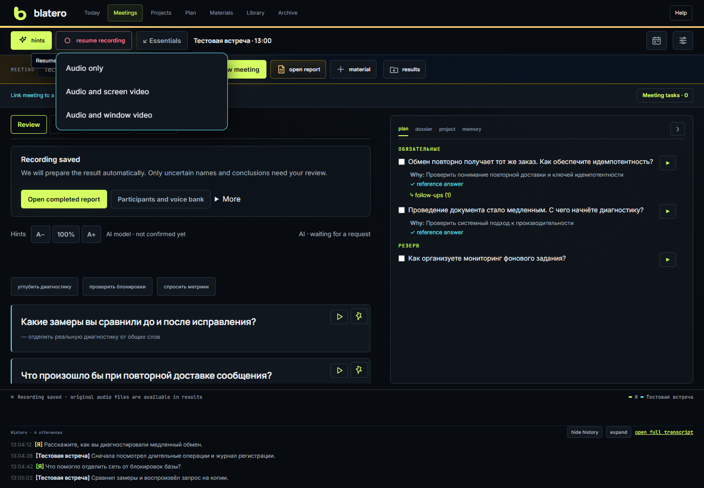
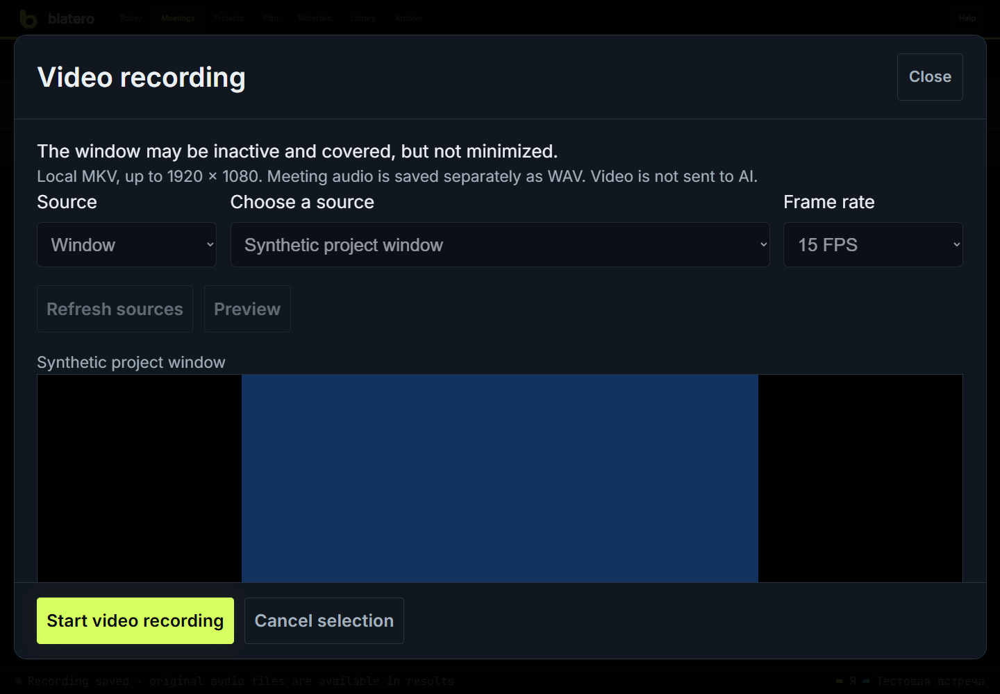

# Screen or window recording

Video is an optional Windows capture path. It does not identify people, stream
to a cloud model or automatically analyze the video.

## Audio together with video

Choose **Record → Audio only / Audio and screen video / Audio and window video**.
For video, select the actual monitor/window, open **Preview**, inspect it, then
choose **Next: start recording** and confirm the meeting start. Preview is not
a meeting recording. Cancel closes it; an unstarted preview expires after 90 s.

**Stop** ends audio and the video linked by that common action. Video failure
leaves audio running with an error message. If audio fails during common startup,
only the linked video is stopped. A standalone video is not silently linked.

## Standalone or additional video

1. Open **+ material → Video** in the selected meeting.
2. Choose window/screen and a concrete source; opening the panel does not capture.
3. Start preview and inspect the image.
4. Choose **Start video recording**. The toolbar stop/timer remains visible in
   the essentials layout.

15/30 fps are available. Output fits 1920×1080 while retaining aspect ratio;
resizing adds letterboxing in the original output size. The selected window can
be inactive or covered. **Do not minimize it.** Closed/minimized/unavailable
sources interrupt video; capture does not fall back to the whole desktop.

## Audio, stopping and files

**MKV has no audio.** Meeting channels remain separate WAVs. Standalone video
does not start or stop microphones/STT. Audio/video muxing into one file is not
part of this version. Closing the panel or browser tab does not stop a server-
owned video. Use **Stop video** and wait for **Video saved**.

Stop video before changing meeting, deleting data or shutting down the server.
Maximum duration is four hours. Disk/size limits can interrupt video without
stopping audio. Download completed MKV or a saved partial in the video history.
Use a Matroska/H.264 player; browser MKV support is not guaranteed.

Under the meeting: `video/UUID/recording.mkv`, preview, state/checksum and worker
log. A crash leaves `recording.partial.mkv`, not a falsely completed file. Last
frames may be incomplete, but retained data is not automatically erased.

Delete through **Settings → Maintenance → Meeting data**, choosing **video and
previews**, calculating the plan and confirming the exact target. Audio is a
different category. Video retention is off by default. Encrypted meeting transfer
includes video subject to package limits.

## Privacy and limits

A monitor records everything visible on it. A window records sensitive content
inside it; no live masking is provided. Switching tabs in a captured browser
window changes the recording: use another window for unrelated work. Separate
dialogs/popups are not necessarily part of the selected window.

Capture is local-computer only. Windows Graphics Capture may block protected
content; the application does not bypass it. Some apps throttle background
rendering. Locking the desktop, monitor disconnect, driver failure or minimizing
does not guarantee continuous video. The video process does not own the WAV path.

Windows portable includes video dependencies. A source installation needs
`requirements-video.txt` in its actual runtime, then an idle server restart.
Video being unavailable does not require changing SpeechKit, voices or keys.
